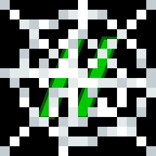

# c0de net



A Minecraft mod that adds network libraries to [c0de](https://github.com/joernott/minecraft-c0de). The first one, `c0de_net/http`, lets c0de programs send HTTP requests to web servers and REST APIs and read the answers. The requests are sent by the game client of the player who runs the program, not by the server.

The mod supports Fabric and NeoForge on Minecraft 1.21.1, 1.21.11, 26.1.2, 26.2 and 26.3, like c0de, and needs c0de 0.3.0 or newer.

## Documentation

  - [Handbook](docs/reference/net.md): the type HTTP_CONNECTION, the functions HTTP_GET to HTTP_PUT, the errors, the settings and examples. With Patchouli on Minecraft 1.21.1, it is also a green book in the game, crafted from an INCLUDE block surrounded by eight strings.
  - [Concept](docs/concept.md): how the library works and why requests run on the client
  - [Implementation plan](docs/implementation_plan.md): sprints and tasks
  - [Development environment](docs/development_environment.md): tools, VM, CI
  - [Changelog](CHANGELOG.md)

## Building

Requirements: JDK 21 or newer to run Gradle. Gradle downloads the JDKs and the c0de jars the build needs.

```sh
./gradlew build                         # builds and tests everything, jars in versions/<node>/build/libs/
./gradlew :core:check                   # formatting and unit tests of the HTTP code (no Minecraft needed)
./gradlew :1.21.1-fabric:runGametest    # runs the GameTests on Fabric
./gradlew :1.21.1-fabric:runClient      # starts the Fabric client with c0de and c0de net
python scripts/generate_book.py         # generates the Patchouli book from the handbook
```

The project uses [Stonecutter](https://stonecutter.kikugie.dev/) like c0de: every combination of Minecraft version and loader is a node, e.g. `1.21.1-fabric`. The committed sources are in the state of the node `1.21.1-fabric`.

## License

BSD 3-clause license, see [LICENSE](LICENSE).
