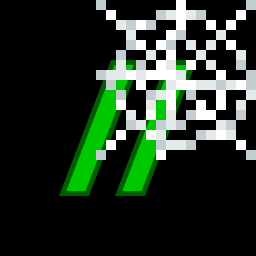

# c0de net



A Minecraft mod that adds network libraries to [c0de](https://github.com/joernott/minecraft-c0de). `c0de_net/http` lets c0de programs send HTTP requests to web servers and REST APIs and read the answers. `c0de_net/mail` sends mail over SMTP and reads and manages mailboxes over IMAP. The requests and mail connections are made by the game client of the player who runs the program, not by the server.

The mod supports Fabric and NeoForge on Minecraft 1.21.1, 1.21.11, 26.1.2, 26.2 and 26.3, like c0de, and needs c0de 0.6.1 or newer. It embeds [Angus Mail](https://eclipse-ee4j.github.io/angus-mail/) for the mail library.

## Documentation

  - [Handbook](docs/reference/net.md): the type HTTP_CONNECTION and the functions HTTP_GET to HTTP_PUT, the types SMTP_SERVER, IMAP_SERVER, MAIL and MAILBOX and the functions SMTP_SEND and IMAP_LIST to IMAP_EXPUNGE, the errors, the settings and examples. In the game, it is one of the handbooks of c0de (since c0de 0.6.1): a red binder with a teal label, crafted from an INCLUDE block surrounded by eight strings.
  - [Handbuch](docs/de/reference/net.md): the handbook in German
  - [Concept](docs/concept.md): how the library works and why requests run on the client
  - [Implementation plan](docs/implementation_plan.md): sprints and tasks
  - [Development environment](docs/development_environment.md): tools, VM, CI
  - [Changelog](CHANGELOG.md)

## Program runner

`c0de-net-runner-<version>.jar`, attached to every GitHub release, brings `c0de_net/http` and `c0de_net/mail` to the [program runner](https://github.com/joernott/minecraft-c0de/blob/main/docs/runner.md) of c0de, which runs programs without Minecraft. Put both jars on the class path (on Windows, separate them with `;`):

```sh
java -cp c0de-runner-0.6.1.jar:c0de-net-runner-<version>.jar de.joernott.c0de.core.runner.Main program.c0de
```

In the runner, the requests and mail connections are made by the runner itself, with the default limits.

## Building

Requirements: JDK 21 or newer to run Gradle. Gradle downloads the JDKs and the c0de jars the build needs.

```sh
./gradlew build                         # builds and tests everything, jars in versions/<node>/build/libs/
./gradlew :core:check                   # formatting and unit tests of the HTTP and mail code (no Minecraft needed)
./gradlew :runner:check :runner:jar     # the runner library c0de-net-runner-<version>.jar and its tests
./gradlew :1.21.1-fabric:runGametest    # runs the GameTests on Fabric
./gradlew :1.21.1-fabric:runClient      # starts the Fabric client with c0de and c0de net
python scripts/generate_book.py         # generates the handbook in the game from the handbook
```

The project uses [Stonecutter](https://stonecutter.kikugie.dev/) like c0de: every combination of Minecraft version and loader is a node, e.g. `1.21.1-fabric`. The committed sources are in the state of the node `1.21.1-fabric`.

## License

BSD 3-clause license, see [LICENSE](LICENSE).
