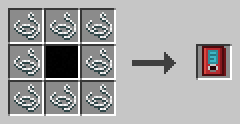

# c0de-net-Handbuch

c0de net ergänzt c0de um die Bibliotheken c0de_net/http und c0de_net/mail. Mit ihnen senden Programme HTTP-Anfragen an Webserver und REST-APIs und lesen die Antworten, senden Mails und lesen Postfächer. Dieses Handbuch beschreibt die Typen, die Funktionen, die Fehler und die Einstellungen, mit Beispielen.

## Erste Schritte

Programme, die eine Bibliothek verwenden, binden sie ein, z. B. mit INCLUDE c0de_net/http oder INCLUDE c0de_net/mail. Ihre Typen und Funktionen beginnen mit dem Namen der Bibliothek, z. B. c0de_net/http/HTTP_GET.

Jedes Programm hat, auch ohne das INCLUDE, die Konstante `C0DE_NET_VERSION` mit der Version von c0de net als Text, z. B. "0.2.0".

### Wie Anfragen gesendet werden

Der Minecraft-Server sendet die Anfragen nicht. Der Spiel-Client des Spielers, der den Prozess ausführt, sendet sie, von dessen Computer aus.

Wenn ein Spieler den Prozess gestartet hat, mit einem Knopf, einem Hebel oder einer Druckplatte am Auslöserblock, ist es dieser Spieler. Wenn niemand ihn gestartet hat, z. B. bei einem Zeitgeberblock oder einer Redstone-Uhr, ist es der Besitzer des Auslöserblocks.

Dieser Spieler muss online sein und c0de net installiert haben. Ein Programm erreicht also, was der Computer dieses Spielers erreichen kann, auch sein Heimnetz. Andere Spieler, die den Knopf drücken, senden die Anfrage von ihrem eigenen Computer, nie von dem des Besitzers.

Eine Anfrage braucht Zeit. Die CALL-Zeile wartet, bis die Antwort ankommt, ein Fehler auftritt oder das Zeitlimit abgelaufen ist. Andere Prozesse und der Server laufen währenddessen weiter.

Wenn der Prozess endet, während eine Anfrage läuft, wird die Anfrage abgebrochen. Nach einem Neustart des Servers sendet ein wiederhergestellter Prozess seine Anfrage erneut. Denk daran bei Anfragen, die Daten ändern, z. B. POST und DELETE.

In einer Einzelspielerwelt laufen Server und Client auf demselben Computer, und Anfragen funktionieren genauso.

Die Funktionen von c0de_net/mail arbeiten genauso: Der Client dieses Spielers verbindet sich mit dem Mailserver.

### Das Handbuch

Dieses Handbuch ist im Spiel ein roter Ordner, eines der Handbücher von c0de (seit c0de 0.6.1), mit einem Etikett in Türkis.

**Rezept**



Umgib einen INCLUDE-Block mit acht Fäden. Schließlich geht es um das World Wide Web.

### Einstellungen

Der Server hat die Datei `config/c0de_net.properties`. `maxResponseSize` begrenzt die Größe einer Antwort in Bytes (1 KiB bis 16 MiB, Standard 1 MiB). `maxRequestsPerPlayer` begrenzt, wie viele Anfragen gleichzeitig auf dem Client eines Spielers laufen (1 bis 64, Standard 8); weitere Anfragen warten.

Für c0de_net/mail hat der Server diese Einstellungen in derselben Datei:

- `enableMail`: false schaltet die Mail-Bibliothek ab (Standard true)
- `maxMailSize`: die Bytes einer Nachricht, die SMTP_SEND sendet (Standard 65536)
- `maxRecipients`: die Empfänger einer Nachricht, to, cc und bcc zusammen (Standard 20)
- `maxMailsPerMinute`: die Nachrichten, die ein Spieler pro Minute senden darf (Standard 10)
- `maxFetchSize`: die Bytes, die ein IMAP_FETCH lesen darf (Standard 1 MiB)
- `maxFetchMessages`: die Nachrichten eines IMAP_FETCH oder IMAP_SEARCH (Standard 100)
- `mailTimeout`: das Standard- und das größte Zeitlimit einer Mail-Verbindung in Sekunden (Standard 30)
- `allowPort25`: true erlaubt Mail-Verbindungen zu Port 25 (Standard false)

Jeder Spieler hat die Datei `config/c0de_net-client.properties`. Mit `allowRequests=false` sendet sein Client keine Anfragen, und die Anfragen seiner Prozesse lösen REQUESTS_DISABLED aus. Mit `allowMail=false` sendet und liest sein Client keine Mails, und die Mail-Funktionen seiner Prozesse lösen MAIL_DISABLED aus.

Beide Dateien werden mit den Standardwerten angelegt. Ungültige Einträge werden im Log gemeldet und durch die Standardwerte ersetzt.

## c0de_net/http

Die HTTP-Bibliothek hat einen Typ für die Verbindung zu einem Server und eine Funktion für jede HTTP-Methode. Alle Funktionen geben die Rohdaten der Antwort, ihren Status und ihre Header zurück.

### HTTP_CONNECTION

Ein Strukturtyp mit den Grundangaben der Anfragen an einen Server.

Deklariere ihn mit `VARIABLE api STRUCT c0de_net/http/HTTP_CONNECTION` und setze seine Elemente mit ASSIGN. Nur `server` ist nötig, alle anderen Elemente beginnen mit Standardwerten, die zu den meisten Servern passen.

- `use_ssl` BOOLEAN: wahr für https, falsch für http (Standard falsch)
- `server` STRING: der Servername oder die IP-Adresse, darf nicht leer sein
- `port` INTEGER: 1 bis 65535, oder 0 für 80 bzw. 443 (Standard 0)
- `base_endpoint` STRING: ein Pfad vor jedem Endpunkt, z. B. /api/v2
- `user` STRING: der Benutzername für die Basic-Authentifizierung, leer für keine
- `password` STRING: das Passwort für die Basic-Authentifizierung
- `skip_ssl_validation` BOOLEAN: wahr, um jedes Zertifikat zu akzeptieren, z. B. ein selbstsigniertes (Standard falsch)
- `proxy` STRING: ein HTTP-Proxy wie http://proxy:3128, leer für keinen
- `headers` HASH STRING: Header, die mit jeder Anfrage gesendet werden, z. B. Content-Type
- `timeout` INTEGER: Sekunden, die eine Anfrage dauern darf, 1 bis 300, oder 0 für 60 (Standard 0)

Die URL einer Anfrage besteht aus dem Protokoll, dem Server, dem Port, dem Basis-Endpunkt und dem Endpunkt, z. B. `https://api.example.com/v2/users/7`. Der Endpunkt wird so verwendet, wie er ist, mit seiner Query, z. B. `/search?q=stone`. Er wird nicht codiert: Ein Leerzeichen oder ein anderes Zeichen, das in einer URL nicht stehen darf, löst INVALID_ARGUMENT aus, z. B. `/search?city=New York`. Codiere solche Zeichen selbst, ein Leerzeichen als `%20` oder, in einer Query, als `+`. REPLACE aus c0de/strings überschreibt Zeichen, ohne die Länge des Textes zu ändern, und kann so jedes Leerzeichen von `city` in `+` verwandeln:

```c0de
CALL c0de/strings/INSTR
    PARAMETER text city ;
    PARAMETER search " " ;
    RESULT result gap
WHILE gap ≥ 0 ;
BEGIN
    CALL c0de/strings/REPLACE
        PARAMETER text city ;
        PARAMETER start gap ;
        PARAMETER insert "+" ;
        RESULT result city
    CALL c0de/strings/INSTR
        PARAMETER text city ;
        PARAMETER search " " ;
        RESULT result gap
END WHILE
```

Ein `Authorization`-Header in `headers` ersetzt die Basic-Authentifizierung. Die Header Host, Content-Length, Connection, Expect und Upgrade können nicht gesetzt werden.

Das Passwort wird im Programm wie jeder andere Wert gespeichert, und jeder, der das Blatt lesen kann, kann es lesen. Übergib Geheimnisse als Parameter, aus einer Konstantenkarte im Auslöserblock.

**Beispiel**

```c0de
PROGRAM connect
NOOP
INCLUDE c0de_net/http
NOOP
FUNCTION run
    PARAMETER token STRING
BEGIN
    VARIABLE api STRUCT c0de_net/http/HTTP_CONNECTION
    ASSIGN api.use_ssl TRUE ;
    ASSIGN api.server "api.example.com" ;
    ASSIGN api.base_endpoint "/v2" ;
    ASSIGN api.headers["Authorization"] "Bearer " ⊕ token ;
    ASSIGN api.headers["Content-Type"] "application/json" ;
    ASSIGN api.timeout 10 ;
END FUNCTION
```

### HTTP_GET

Sendet eine GET-Anfrage und gibt die Antwort zurück.

GET liest Daten. Weiterleitungen werden verfolgt, außer von https zu http. Die Ergebnisse sind die der letzten Antwort. Ein Status von 400 oder höher löst HTTP_STATUS aus, und die Ergebnisse werden trotzdem geliefert.

**Parameter und Ergebnisse**

- `connection` STRUCT c0de_net/http/HTTP_CONNECTION: der Server
- `endpoint` STRING: der Pfad hinter dem Basis-Endpunkt (optional, Standard leer)
- Ergebnis `result` STRING: die Rohdaten der Antwort
- Ergebnis `status` INTEGER: der HTTP-Status, z. B. 200
- Ergebnis `headers` HASH STRING: die Header der Antwort, mit kleingeschriebenen Namen

**Beispiel**

```c0de
CALL c0de_net/http/HTTP_GET
    PARAMETER connection api ;
    PARAMETER endpoint "/forecast?city=Berlin" ;
    RESULT result answer
```

### HTTP_HEAD

Sendet eine HEAD-Anfrage: wie GET, aber die Antwort hat keine Daten.

`result` enthält stattdessen die Header der Antwort als JSON-Objekt, mit kleingeschriebenen Namen in alphabetischer Reihenfolge, z. B. `{"content-length":"12"}`.

**Parameter und Ergebnisse**

- `connection` STRUCT c0de_net/http/HTTP_CONNECTION: der Server
- `endpoint` STRING: der Pfad hinter dem Basis-Endpunkt (optional, Standard leer)
- Ergebnis `result` STRING: die Header als JSON
- Ergebnis `status` INTEGER: der HTTP-Status
- Ergebnis `headers` HASH STRING: die Header der Antwort

**Beispiel**

```c0de
CALL c0de_net/http/HTTP_HEAD
    PARAMETER connection api ;
    PARAMETER endpoint "/status" ;
    RESULT status status
```

### HTTP_OPTIONS

Sendet eine OPTIONS-Anfrage: fragt den Server, welche Methoden ein Endpunkt unterstützt.

Viele Server antworten im Header `allow`.

**Parameter und Ergebnisse**

- `connection` STRUCT c0de_net/http/HTTP_CONNECTION: der Server
- `endpoint` STRING: der Pfad hinter dem Basis-Endpunkt (optional, Standard leer)
- Ergebnis `result` STRING: die Rohdaten der Antwort
- Ergebnis `status` INTEGER: der HTTP-Status
- Ergebnis `headers` HASH STRING: die Header der Antwort

**Beispiel**

```c0de
CALL c0de_net/http/HTTP_OPTIONS
    PARAMETER connection api ;
    PARAMETER endpoint "/lamps" ;
    RESULT headers answerHeaders
```

### HTTP_TRACE

Sendet eine TRACE-Anfrage: Der Server schickt die Anfrage so zurück, wie er sie empfangen hat.

Damit siehst du, was ein Proxy ändert. Viele Server erlauben TRACE nicht und antworten mit 405.

**Parameter und Ergebnisse**

- `connection` STRUCT c0de_net/http/HTTP_CONNECTION: der Server
- `endpoint` STRING: der Pfad hinter dem Basis-Endpunkt (optional, Standard leer)
- Ergebnis `result` STRING: die Rohdaten der Antwort
- Ergebnis `status` INTEGER: der HTTP-Status
- Ergebnis `headers` HASH STRING: die Header der Antwort

**Beispiel**

```c0de
CALL c0de_net/http/HTTP_TRACE
    PARAMETER connection api ;
    RESULT result echo
```

### HTTP_DELETE

Sendet eine DELETE-Anfrage: entfernt etwas auf dem Server.

Manche APIs erwarten dabei Daten, die meisten nicht.

**Parameter und Ergebnisse**

- `connection` STRUCT c0de_net/http/HTTP_CONNECTION: der Server
- `endpoint` STRING: der Pfad hinter dem Basis-Endpunkt (optional, Standard leer)
- `data` STRING: die Daten, die mit der Anfrage gesendet werden, in UTF-8 (optional, Standard leer)
- Ergebnis `result` STRING: die Rohdaten der Antwort
- Ergebnis `status` INTEGER: der HTTP-Status
- Ergebnis `headers` HASH STRING: die Header der Antwort

**Beispiel**

```c0de
CALL c0de_net/http/HTTP_DELETE
    PARAMETER connection api ;
    PARAMETER endpoint "/timers/3" ;
    RESULT status status
```

### HTTP_PATCH

Sendet eine PATCH-Anfrage: ändert einen Teil von etwas auf dem Server.

Die Daten werden als UTF-8 gesendet. Setze ihren Typ im Header `Content-Type` der Verbindung, z. B. `application/json`.

**Parameter und Ergebnisse**

- `connection` STRUCT c0de_net/http/HTTP_CONNECTION: der Server
- `endpoint` STRING: der Pfad hinter dem Basis-Endpunkt (optional, Standard leer)
- `data` STRING: die Daten, die mit der Anfrage gesendet werden (optional, Standard leer)
- Ergebnis `result` STRING: die Rohdaten der Antwort
- Ergebnis `status` INTEGER: der HTTP-Status
- Ergebnis `headers` HASH STRING: die Header der Antwort

**Beispiel**

`state` ist eine BOOLEAN-Variable mit dem Tag `json: "on"`, darum schreibt TO_JSON aus c0de/strings `{"on":false}` (siehe das Beispiel Eine Lampe schalten).

```c0de
CALL c0de/strings/TO_JSON
    PARAMETER value state ;
    RESULT result data
CALL c0de_net/http/HTTP_PATCH
    PARAMETER connection api ;
    PARAMETER endpoint "/lamps/kitchen" ;
    PARAMETER data data ;
    RESULT status status
```

### HTTP_POST

Sendet eine POST-Anfrage: sendet Daten an den Server, z. B. um etwas anzulegen.

Die Daten werden als UTF-8 gesendet. Setze ihren Typ im Header `Content-Type` der Verbindung. Erzeuge die Daten mit TO_JSON aus c0de/strings.

**Parameter und Ergebnisse**

- `connection` STRUCT c0de_net/http/HTTP_CONNECTION: der Server
- `endpoint` STRING: der Pfad hinter dem Basis-Endpunkt (optional, Standard leer)
- `data` STRING: die Daten, die mit der Anfrage gesendet werden (optional, Standard leer)
- Ergebnis `result` STRING: die Rohdaten der Antwort
- Ergebnis `status` INTEGER: der HTTP-Status
- Ergebnis `headers` HASH STRING: die Header der Antwort

**Beispiel**

```c0de
CALL c0de_net/http/HTTP_POST
    PARAMETER connection api ;
    PARAMETER endpoint "/messages" ;
    PARAMETER data message ;
    RESULT result answer
```

### HTTP_PUT

Sendet eine PUT-Anfrage: speichert etwas auf dem Server und ersetzt, was vorher da war.

Die Daten werden als UTF-8 gesendet. Setze ihren Typ im Header `Content-Type` der Verbindung.

**Parameter und Ergebnisse**

- `connection` STRUCT c0de_net/http/HTTP_CONNECTION: der Server
- `endpoint` STRING: der Pfad hinter dem Basis-Endpunkt (optional, Standard leer)
- `data` STRING: die Daten, die mit der Anfrage gesendet werden (optional, Standard leer)
- Ergebnis `result` STRING: die Rohdaten der Antwort
- Ergebnis `status` INTEGER: der HTTP-Status
- Ergebnis `headers` HASH STRING: die Header der Antwort

**Beispiel**

```c0de
CALL c0de_net/http/HTTP_PUT
    PARAMETER connection api ;
    PARAMETER endpoint "/lamps/kitchen" ;
    PARAMETER data state ;
    RESULT status status
```

## c0de_net/mail

Die Mail-Bibliothek sendet Mails über SMTP und liest und verwaltet Postfächer über IMAP. Mails sind reiner Text, ohne HTML und Anhänge.

Jede Funktion öffnet eine eigene Verbindung, meldet sich an, erledigt ihre Arbeit und meldet sich ab. Zwischen zwei Aufrufen bleibt nichts offen. Die Funktionen für Nachrichten arbeiten in dem Ordner, den IMAP_SELECT in der IMAP_SERVER-Variable gespeichert hat; gib ihnen also diese Variable.

### SMTP_SERVER

Ein Strukturtyp mit der Verbindung zu einem Server, der Mails sendet, z. B. dem deines Mail-Anbieters.

Deklariere ihn mit `VARIABLE smtp STRUCT c0de_net/mail/SMTP_SERVER` und setze seine Elemente mit ASSIGN. `server` und `from` sind nötig, die anderen Elemente beginnen mit Standardwerten, die zu den meisten Anbietern passen.

- `server` STRING: der Servername, z. B. smtp.example.com
- `port` INTEGER: 1 bis 65535, oder 0 für 465 mit `tls` und sonst 587 (Standard 0)
- `security` STRING: `starttls` (der Standard für einen leeren Text), `tls` für eine Verbindung, die von Anfang an verschlüsselt ist, oder `none`
- `user` STRING: der Benutzername, leer, um ohne Anmeldung zu senden
- `password` STRING: das Passwort
- `from` STRING: die Adresse des Absenders, z. B. `Base computer <steve@example.com>`
- `timeout` INTEGER: Sekunden, die ein Aufruf dauern darf, oder 0 für den Standard des Servers (30 Sekunden, das ist auch der größte Wert)
- `skip_ssl_validation` BOOLEAN: true, um jedes Zertifikat anzunehmen, z. B. eines Servers in deinem Heimnetz (Standard false)

Port 25 ist gesperrt, außer der Server erlaubt ihn. Verwende den Einlieferungsport deines Mail-Anbieters, 465 oder 587.

Das Element `password` hat das Tag `security: "sensitive"`, deshalb zeigt das Debugging-Werkzeug `***` statt seines Werts. Schreib es wie bei HTTP_CONNECTION nicht ins Programm: Übergib es als Parameter oder lies es aus dem Tresor von c0de.

**Beispiel**

```c0de
PROGRAM postman
NOOP
INCLUDE c0de_net/mail
NOOP
FUNCTION run
    PARAMETER password STRING
BEGIN
    VARIABLE smtp STRUCT c0de_net/mail/SMTP_SERVER
    ASSIGN smtp.server "smtp.example.com" ;
    ASSIGN smtp.user "steve@example.com" ;
    ASSIGN smtp.password password ;
    ASSIGN smtp.from "Base computer <steve@example.com>" ;
END FUNCTION
```

### IMAP_SERVER

Ein Strukturtyp mit der Verbindung zu einem Server mit Postfächern.

Deklariere ihn mit `VARIABLE imap STRUCT c0de_net/mail/IMAP_SERVER`. `server` und `user` sind nötig.

- `server` STRING: der Servername, z. B. imap.example.com
- `port` INTEGER: 1 bis 65535, oder 0 für 993 mit `tls` und sonst 143 (Standard 0)
- `security` STRING: `tls` (der Standard für einen leeren Text), `starttls` oder `none`
- `user` STRING: der Benutzername
- `password` STRING: das Passwort, vertraulich wie das von SMTP_SERVER
- `timeout` INTEGER: wie bei SMTP_SERVER
- `skip_ssl_validation` BOOLEAN: wie bei SMTP_SERVER
- `folder` STRING: der ausgewählte Ordner; IMAP_SELECT setzt ihn

**Beispiel**

```c0de
VARIABLE imap STRUCT c0de_net/mail/IMAP_SERVER
ASSIGN imap.server "imap.example.com" ;
ASSIGN imap.user "steve@example.com" ;
ASSIGN imap.password password ;
```

### MAIL

Ein Strukturtyp mit einer Nachricht, die IMAP_FETCH gelesen hat.

- `uid` INTEGER: die Nummer der Nachricht in ihrem Ordner
- `from` STRING: der Absender
- `to` ARRAY STRING: die Empfänger
- `cc` ARRAY STRING: die Empfänger von Kopien
- `subject` STRING: der Betreff
- `date` TIME: wann die Nachricht gesendet wurde
- `text` STRING: der reine Text der Nachricht, leer bei einer Nachricht ohne ihn oder wenn IMAP_FETCH ihn nicht gelesen hat
- `flags` ARRAY STRING: die Flags, z. B. `\Seen`
- `size` INTEGER: die Größe in Bytes

### MAILBOX

Ein Strukturtyp mit dem Status eines Ordners, von IMAP_STATUS und IMAP_SELECT.

- `name` STRING: der Name des Ordners
- `messages` INTEGER: die Zahl der Nachrichten
- `recent` INTEGER: die Zahl der neuen Nachrichten seit dem letzten Blick
- `unseen` INTEGER: die Zahl der Nachrichten ohne das Flag `\Seen`
- `uid_next` INTEGER: die UID, die die nächste Nachricht bekommt
- `uid_validity` INTEGER: ändert sich, wenn die UIDs des Ordners neu vergeben werden

### SMTP_SEND

Sendet eine Nachricht als reinen Text und gibt ihre Message-ID zurück.

Alle Empfänger zusammen, to, cc und bcc, dürfen höchstens 20 sein, und die Nachricht höchstens 64 KiB groß. Ein Spieler darf 10 Nachrichten pro Minute senden. Der Server kann diese Grenzen ändern.

**Parameter und Ergebnisse**

- `server` STRUCT c0de_net/mail/SMTP_SERVER: der Server
- `to` STRING oder ARRAY STRING: die Empfänger
- `subject` STRING: der Betreff (optional, Standard leer)
- `text` STRING: der Text (optional, Standard leer)
- `cc` ARRAY STRING: Empfänger von Kopien (optional, Standard keine)
- `bcc` ARRAY STRING: Empfänger von Kopien, die die anderen nicht sehen (optional, Standard keine)
- `reply_to` STRING: die Adresse für Antworten (optional, Standard leer: der Absender)
- Ergebnis `result` STRING: die Message-ID

**Beispiel**

```c0de
CALL c0de_net/mail/SMTP_SEND
    PARAMETER server smtp ;
    PARAMETER to "alex@example.com" ;
    PARAMETER subject "The farm" ;
    PARAMETER text "The wheat is ready." ;
```

### IMAP_LIST

Gibt die Namen der Ordner zurück.

Im Muster steht `*` für beliebigen Text und `%` für beliebigen Text innerhalb einer Ordnerebene.

**Parameter und Ergebnisse**

- `server` STRUCT c0de_net/mail/IMAP_SERVER: der Server
- `pattern` STRING: die Ordner, die aufgelistet werden (optional, Standard `*`: alle)
- Ergebnis `result` ARRAY STRING: die Namen der Ordner

**Beispiel**

```c0de
CALL c0de_net/mail/IMAP_LIST
    PARAMETER server imap ;
    RESULT result folders
```

### IMAP_CREATE

Legt einen Ordner an.

Ein Ordner, den es schon gibt, löst MAIL_REJECTED aus.

**Parameter und Ergebnisse**

- `server` STRUCT c0de_net/mail/IMAP_SERVER: der Server
- `folder` STRING: der Name des neuen Ordners

**Beispiel**

```c0de
CALL c0de_net/mail/IMAP_CREATE
    PARAMETER server imap ;
    PARAMETER folder "Orders" ;
```

### IMAP_DELETE

Löscht einen Ordner mit seinen Nachrichten.

**Parameter und Ergebnisse**

- `server` STRUCT c0de_net/mail/IMAP_SERVER: der Server
- `folder` STRING: der Name des Ordners

**Beispiel**

```c0de
CALL c0de_net/mail/IMAP_DELETE
    PARAMETER server imap ;
    PARAMETER folder "Old orders" ;
```

### IMAP_RENAME

Benennt einen Ordner um.

**Parameter und Ergebnisse**

- `server` STRUCT c0de_net/mail/IMAP_SERVER: der Server
- `folder` STRING: der Name des Ordners
- `new_name` STRING: sein neuer Name

**Beispiel**

```c0de
CALL c0de_net/mail/IMAP_RENAME
    PARAMETER server imap ;
    PARAMETER folder "Orders" ;
    PARAMETER new_name "Old orders" ;
```

### IMAP_STATUS

Gibt den Status eines Ordners zurück, ohne ihn auszuwählen.

**Parameter und Ergebnisse**

- `server` STRUCT c0de_net/mail/IMAP_SERVER: der Server
- `folder` STRING: der Ordner (optional, Standard leer: der ausgewählte Ordner)
- Ergebnis `result` STRUCT c0de_net/mail/MAILBOX: sein Status

**Beispiel**

```c0de
CALL c0de_net/mail/IMAP_STATUS
    PARAMETER server imap ;
    PARAMETER folder "INBOX" ;
    RESULT result box
```

### IMAP_SELECT

Wählt einen Ordner aus: prüft, dass es ihn gibt, und speichert seinen Namen in `folder` der Variable.

Übergib die Variable selbst, keine Berechnung, denn die Funktion ändert sie. Die Funktionen für Nachrichten, IMAP_SEARCH, IMAP_FETCH, IMAP_STORE, IMAP_MOVE und IMAP_EXPUNGE, arbeiten im ausgewählten Ordner.

**Parameter und Ergebnisse**

- `server` STRUCT c0de_net/mail/IMAP_SERVER: eine Variable mit dem Server
- `folder` STRING: der Ordner (optional, Standard `INBOX`)
- Ergebnis `result` STRUCT c0de_net/mail/MAILBOX: sein Status

**Beispiel**

```c0de
CALL c0de_net/mail/IMAP_SELECT
    PARAMETER server imap ;
    PARAMETER folder "INBOX" ;
    RESULT result box
```

### IMAP_SEARCH

Gibt die UIDs der Nachrichten des ausgewählten Ordners zurück, die zu den Kriterien passen, die älteste zuerst.

Die Kriterien sind Wörter von IMAP, getrennt durch Leerzeichen, und alle müssen passen: `ALL`, `SEEN`, `UNSEEN`, `FLAGGED`, `UNFLAGGED`, `ANSWERED`, `UNANSWERED`, `DELETED`, `UNDELETED`, `DRAFT`, und mit einem Wert dahinter `FROM`, `TO`, `CC`, `SUBJECT` und `BODY` mit einem Text, `SINCE`, `BEFORE` und `ON` mit einem Datum wie 1-Nov-2026. Ein Text mit Leerzeichen kommt in doppelte Anführungszeichen, z. B. `SUBJECT \"wheat order\"` in der Textnotation. Bei mehr Treffern, als der Server erlaubt (100), kommen die neuesten zurück.

**Parameter und Ergebnisse**

- `server` STRUCT c0de_net/mail/IMAP_SERVER: der Server mit dem ausgewählten Ordner
- `criteria` STRING: die Kriterien (optional, Standard `ALL`)
- Ergebnis `result` ARRAY INTEGER: die UIDs

**Beispiel**

```c0de
CALL c0de_net/mail/IMAP_SEARCH
    PARAMETER server imap ;
    PARAMETER criteria "UNSEEN FROM alex" ;
    RESULT result uids
```

### IMAP_FETCH

Liest Nachrichten des ausgewählten Ordners.

Eine UID, die es nicht gibt, wird ausgelassen. Das Lesen des Texts markiert eine Nachricht als gelesen, wie ein Mailprogramm es tut; mit `text` FALSE werden nur die anderen Elemente gelesen, und die Nachricht bleibt ungelesen. Ein Aufruf liest höchstens 100 Nachrichten und 1 MiB, sonst löst er RESPONSE_TOO_LARGE aus.

**Parameter und Ergebnisse**

- `server` STRUCT c0de_net/mail/IMAP_SERVER: der Server mit dem ausgewählten Ordner
- `uids` INTEGER oder ARRAY INTEGER: die UIDs der Nachrichten
- `text` BOOLEAN: ob der Text gelesen wird (optional, Standard TRUE)
- Ergebnis `result` ARRAY STRUCT c0de_net/mail/MAIL: die Nachrichten

**Beispiel**

```c0de
CALL c0de_net/mail/IMAP_FETCH
    PARAMETER server imap ;
    PARAMETER uids uids ;
    RESULT result letters
```

### IMAP_STORE

Ändert die Flags von Nachrichten des ausgewählten Ordners.

Die Flags von IMAP sind `\Seen`, `\Answered`, `\Flagged`, `\Deleted` und `\Draft`; andere Wörter sind Schlüsselwörter, wenn der Server sie unterstützt. Der Modus `add` fügt die Flags hinzu, `remove` entfernt sie und `set` ersetzt alle Flags. In der Textnotation wird ein Backslash doppelt geschrieben: `"\\Seen"`.

**Parameter und Ergebnisse**

- `server` STRUCT c0de_net/mail/IMAP_SERVER: der Server mit dem ausgewählten Ordner
- `uids` INTEGER oder ARRAY INTEGER: die UIDs der Nachrichten
- `flags` STRING oder ARRAY STRING: die Flags
- `mode` STRING: `add`, `remove` oder `set` (optional, Standard `add`)

**Beispiel**

```c0de
CALL c0de_net/mail/IMAP_STORE
    PARAMETER server imap ;
    PARAMETER uids uids ;
    PARAMETER flags "\\Seen" ;
```

### IMAP_MOVE

Verschiebt Nachrichten des ausgewählten Ordners in einen anderen Ordner.

**Parameter und Ergebnisse**

- `server` STRUCT c0de_net/mail/IMAP_SERVER: der Server mit dem ausgewählten Ordner
- `uids` INTEGER oder ARRAY INTEGER: die UIDs der Nachrichten
- `folder` STRING: der Ordner, in den sie kommen

**Beispiel**

```c0de
CALL c0de_net/mail/IMAP_MOVE
    PARAMETER server imap ;
    PARAMETER uids uids ;
    PARAMETER folder "Orders" ;
```

### IMAP_EXPUNGE

Entfernt die Nachrichten des ausgewählten Ordners, die das Flag `\Deleted` haben, und gibt zurück, wie viele.

**Parameter und Ergebnisse**

- `server` STRUCT c0de_net/mail/IMAP_SERVER: der Server mit dem ausgewählten Ordner
- Ergebnis `result` INTEGER: die Zahl der entfernten Nachrichten

**Beispiel**

```c0de
CALL c0de_net/mail/IMAP_EXPUNGE
    PARAMETER server imap ;
    RESULT result removed
```

## Fehler

Die Funktionen lösen diese Fehler aus. Fang sie mit einer Variable vom Typ ERROR in der CALL-Zeile ab und vergleiche ihren `code` mit den Konstanten der Bibliothek, z. B. `c0de_net/http/HTTP_STATUS`. Sie enthalten die Codes und kommen wie die Funktionen mit dem INCLUDE. c0de_net/mail hat die Konstanten der Fehler, die es auslöst, z. B. `c0de_net/mail/REQUEST_FAILED`. INVALID_ARGUMENT und PERMISSION_DENIED sind Konstanten von c0de.

### INVALID_ARGUMENT

Code 309: Die Verbindung oder der Endpunkt ist ungültig.

Der Server ist leer, der Port liegt nicht zwischen 0 und 65535, das Zeitlimit liegt nicht zwischen 0 und 300, der Proxy ist keine http://-URL, oder ein Header kann nicht gesendet werden. Der Endpunkt macht die URL ungültig, z. B. mit einem Leerzeichen (siehe HTTP_CONNECTION). Der Fehler wird auch ausgelöst, wenn die Anfrage größer als 1.000.000 Bytes ist.

Für c0de_net/mail: eine Verbindung ohne Server, ein SMTP_SERVER ohne `from`, ein IMAP_SERVER ohne `user`, ein unbekanntes `security`, ein Zeitlimit über dem größten, eine ungültige Adresse, unbekannte Kriterien von IMAP_SEARCH, ein unbekannter `mode` von IMAP_STORE oder eine Funktion für Nachrichten ohne ausgewählten Ordner.

### PERMISSION_DENIED

Code 311: eine Mail-Verbindung zu Port 25, die der Server nicht erlaubt.

Über Port 25 nehmen Mailserver Mails voneinander an, und Spammer nutzen ihn auch. Sende über den Einlieferungsport deines Mail-Anbieters, 465 oder 587, der Benutzername und Passwort braucht.

### HTTP_STATUS

Code 1000, `c0de_net/http/HTTP_STATUS`: Der Server hat mit einem Status von 400 oder höher geantwortet.

Die Meldung ist die Statuszeile, z. B. `404 Not Found`. Die Ergebnisse `result`, `status` und `headers` werden trotzdem geliefert, so kann ein Programm, das den Fehler abfängt, die Antwort lesen.

**Beispiel**

```c0de
CALL c0de_net/http/HTTP_GET problem
    PARAMETER connection api ;
    PARAMETER endpoint "/lamps/attic" ;
    RESULT status status
IF problem.code = c0de_net/http/HTTP_STATUS AND status = 404 ;
BEGIN
    CALL PRINT
        PARAMETER value "There is no lamp in the attic" ;
END IF
```

### CLIENT_UNAVAILABLE

Code 1001, `c0de_net/http/CLIENT_UNAVAILABLE`: Es gibt keinen Client, der die Anfrage sendet.

Der Spieler, der den Prozess ausführt, ist nicht online, oder in seinem Spiel ist c0de net nicht installiert. Ein Prozess, den niemand gestartet hat und dessen Auslöserblock keinen Besitzer hat, kann ebenfalls keine Anfragen senden.

### REQUESTS_DISABLED

Code 1002, `c0de_net/http/REQUESTS_DISABLED`: Der Client des Spielers, der den Prozess ausführt, sendet keine Anfragen.

Dieser Spieler hat `allowRequests=false` in `config/c0de_net-client.properties` gesetzt.

### REQUEST_FAILED

Code 1003, `c0de_net/http/REQUEST_FAILED`: Die Anfrage konnte nicht gesendet werden, oder es kam keine Antwort.

Die Meldung nennt den Grund, z. B. einen unbekannten Host, eine abgelehnte Verbindung, einen fehlgeschlagenen SSL-Handshake oder einen Proxy-Fehler. Ein selbstsigniertes Zertifikat braucht `skip_ssl_validation`.

### REQUEST_TIMEOUT

Code 1004, `c0de_net/http/REQUEST_TIMEOUT`: Innerhalb des Zeitlimits der Verbindung kam keine vollständige Antwort.

Das Zeitlimit gilt für die ganze Anfrage, bis zum letzten Byte der Antwort. Erhöhe `timeout` für langsame Server, bis zu 300 Sekunden.

### RESPONSE_TOO_LARGE

Code 1005, `c0de_net/http/RESPONSE_TOO_LARGE`: Die Antwort ist größer, als der Server erlaubt.

Die Grenze ist `maxResponseSize` in `config/c0de_net.properties`, standardmäßig 1 MiB. Frag bei der API weniger Daten an, z. B. eine Seite einer Liste.

Für IMAP_FETCH ist die Grenze `maxFetchSize`. Lies weniger Nachrichten auf einmal oder ohne ihren Text.

### MAIL_DISABLED

Code 1006, `c0de_net/mail/MAIL_DISABLED`: Mail ist abgeschaltet.

Der Server hat `enableMail=false` in `config/c0de_net.properties` gesetzt, oder der Spieler, der den Prozess ausführt, hat `allowMail=false` in `config/c0de_net-client.properties` gesetzt.

### AUTHENTICATION_FAILED

Code 1007, `c0de_net/mail/AUTHENTICATION_FAILED`: Der Mailserver hat den Benutzernamen oder das Passwort nicht angenommen.

Viele Anbieter wollen für Programme ein App-Passwort statt des Passworts des Kontos.

### MAIL_REJECTED

Code 1008, `c0de_net/mail/MAIL_REJECTED`: Der Mailserver hat den Befehl abgelehnt.

Z. B. einen Empfänger, den er nicht annimmt, einen Ordner, den es nicht gibt, oder einen Ordner zum Anlegen, den es schon gibt. Die Meldung ist die Antwort des Servers.

### MAIL_LIMIT

Code 1009, `c0de_net/mail/MAIL_LIMIT`: Eine Grenze des Servers ist erreicht.

Mehr Empfänger als `maxRecipients`, eine größere Nachricht als `maxMailSize` oder mehr Nachrichten eines Spielers pro Minute als `maxMailsPerMinute`. Warte eine Minute, bevor du wieder sendest.

## Beispiele

Vollständige Programme, die c0de_net/http und c0de_net/mail verwenden. Die Server sind Beispiele; ersetze sie durch die API oder den Mail-Anbieter, den du verwenden willst.

### Wettervorhersage

Liest eine Vorhersage als JSON und gibt sie aus.

FROM_JSON aus c0de/strings liest die Antwort in eine Struktur ein. Die Elemente der Struktur müssen zu den Schlüsseln des JSON-Objekts passen.

```c0de
PROGRAM weather
NOOP
INCLUDE c0de_net/http
INCLUDE c0de/strings
NOOP
STRUCT forecast
BEGIN
    sky STRING
    temperature FLOAT
END STRUCT
NOOP
FUNCTION show
BEGIN
    VARIABLE api STRUCT c0de_net/http/HTTP_CONNECTION
    VARIABLE answer STRING
    VARIABLE today STRUCT forecast
    ASSIGN api.use_ssl TRUE ;
    ASSIGN api.server "weather.example.com" ;
    CALL c0de_net/http/HTTP_GET
        PARAMETER connection api ;
        PARAMETER endpoint "/today?city=Berlin" ;
        RESULT result answer
    CALL c0de/strings/FROM_JSON
        PARAMETER source answer ;
        PARAMETER destination today ;
    CALL PRINT
        PARAMETER value today.sky ⊕ ", " ⊕ today.temperature ⊕ " °C" ;
END FUNCTION
```

### Eine Lampe schalten

Schaltet eine Lampe einer Hausautomation ein oder aus.

Stell den Auslöserblock neben einen Hebel und gib ihm eine Konstantenkarte `token` mit dem Token deiner Hausautomation. Die Anfrage wird vom Computer des Spielers gesendet, der den Hebel umlegt, also können nur Spieler in deinem Heimnetz die Lampe schalten.

```c0de
PROGRAM lamp
NOOP
INCLUDE c0de_net/http
INCLUDE c0de/strings
NOOP
FUNCTION switch
    PARAMETER token STRING
    PARAMETER on BOOLEAN TRUE
    RESULT status INTEGER
BEGIN
    VARIABLE api STRUCT c0de_net/http/HTTP_CONNECTION
    VARIABLE state BOOLEAN TAG(json: "on")
    VARIABLE data STRING
    ASSIGN api.server "192.168.1.20" ;
    ASSIGN api.port 8123 ;
    ASSIGN api.base_endpoint "/api" ;
    ASSIGN api.headers["Authorization"] "Bearer " ⊕ token ;
    ASSIGN api.headers["Content-Type"] "application/json" ;
    ASSIGN state on ;
    CALL c0de/strings/TO_JSON
        PARAMETER value state ;
        RESULT result data
    CALL c0de_net/http/HTTP_PUT
        PARAMETER connection api ;
        PARAMETER endpoint "/lamps/kitchen" ;
        PARAMETER data data ;
        RESULT status status
END FUNCTION
```

### Fehler behandeln

Prüft, ob ein Server antwortet, und gibt einen Exit-Code zurück, statt abzustürzen.

Der Exit-Code ist 0, wenn der Server antwortet, 1, wenn er mit einem Fehlerstatus antwortet, und 2, wenn keine Antwort kommt. Ein Komparator neben dem Auslöserblock liest ihn aus.

```c0de
PROGRAM ping
NOOP
INCLUDE c0de_net/http
NOOP
FUNCTION check
    PARAMETER host STRING
BEGIN
    VARIABLE api STRUCT c0de_net/http/HTTP_CONNECTION
    VARIABLE problem ERROR
    ASSIGN api.use_ssl TRUE ;
    ASSIGN api.server host ;
    ASSIGN api.timeout 5 ;
    CALL c0de_net/http/HTTP_HEAD problem
        PARAMETER connection api ;
    IF problem.code = c0de_net/http/HTTP_STATUS ;
    BEGIN
        EXIT 1 ;
    END IF
    IF problem.code ≠ 0 ;
    BEGIN
        EXIT 2 ;
    END IF
    EXIT 0 ;
END FUNCTION
```

### Mail von der Farm

Sendet eine Nachricht, wenn die Farm voll ist.

Stell den Auslöserblock neben einen Komparator an der Truhe der Farm und gib ihm ein Konstanten-Item `password` mit dem Passwort deines Mail-Kontos. Die Nachricht wird vom Computer des Spielers gesendet, dem der Auslöserblock gehört.

```c0de
PROGRAM farm_mail
NOOP
INCLUDE c0de_net/mail
NOOP
FUNCTION full
    PARAMETER password STRING
BEGIN
    VARIABLE smtp STRUCT c0de_net/mail/SMTP_SERVER
    ASSIGN smtp.server "smtp.example.com" ;
    ASSIGN smtp.user "steve@example.com" ;
    ASSIGN smtp.password password ;
    ASSIGN smtp.from "Farm <steve@example.com>" ;
    CALL c0de_net/mail/SMTP_SEND
        PARAMETER server smtp ;
        PARAMETER to "steve@example.com" ;
        PARAMETER subject "The farm is full" ;
        PARAMETER text "Come and empty the chest." ;
END FUNCTION
```

### Bestellungen lesen

Liest die ungelesenen Nachrichten mit "order" im Betreff, gibt ihre Betreffs aus und verschiebt sie in den Ordner Orders.

```c0de
PROGRAM orders
NOOP
INCLUDE c0de_net/mail
NOOP
FUNCTION read
    PARAMETER password STRING
    RESULT count INTEGER
BEGIN
    VARIABLE imap STRUCT c0de_net/mail/IMAP_SERVER
    VARIABLE box STRUCT c0de_net/mail/MAILBOX
    VARIABLE uids ARRAY INTEGER
    VARIABLE letters ARRAY STRUCT c0de_net/mail/MAIL
    ASSIGN imap.server "imap.example.com" ;
    ASSIGN imap.user "steve@example.com" ;
    ASSIGN imap.password password ;
    CALL c0de_net/mail/IMAP_SELECT
        PARAMETER server imap ;
        RESULT result box
    CALL c0de_net/mail/IMAP_SEARCH
        PARAMETER server imap ;
        PARAMETER criteria "UNSEEN SUBJECT order" ;
        RESULT result uids
    CALL c0de_net/mail/IMAP_FETCH
        PARAMETER server imap ;
        PARAMETER uids uids ;
        RESULT result letters
    EACH letter letters
    BEGIN
        CALL PRINT
            PARAMETER value letter.from ⊕ ": " ⊕ letter.subject ;
    END EACH
    CALL c0de_net/mail/IMAP_MOVE
        PARAMETER server imap ;
        PARAMETER uids uids ;
        PARAMETER folder "Orders" ;
    CALL LEN
        PARAMETER value uids ;
        RESULT result count
END FUNCTION
```
