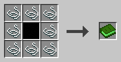

# c0de-net-Handbuch

c0de net ergänzt c0de um die Bibliothek c0de_net/http. Mit ihr senden Programme HTTP-Anfragen an Webserver und REST-APIs und lesen die Antworten. Dieses Handbuch beschreibt den Verbindungstyp, die Funktionen, die Fehler und die Einstellungen, mit Beispielen.

## Erste Schritte

Programme, die die Bibliothek verwenden, binden sie mit INCLUDE c0de_net/http ein. Ihr Typ und ihre Funktionen beginnen mit dem Namen der Bibliothek, z. B. c0de_net/http/HTTP_GET.

Jedes Programm hat, auch ohne das INCLUDE, die Konstante `C0DE_NET_VERSION` mit der Version von c0de net als Text, z. B. "0.2.0".

### Wie Anfragen gesendet werden

Der Minecraft-Server sendet die Anfragen nicht. Der Spiel-Client des Spielers, der den Prozess ausführt, sendet sie, von dessen Computer aus.

Wenn ein Spieler den Prozess gestartet hat, mit einem Knopf, einem Hebel oder einer Druckplatte am Auslöserblock, ist es dieser Spieler. Wenn niemand ihn gestartet hat, z. B. bei einem Zeitgeberblock oder einer Redstone-Uhr, ist es der Besitzer des Auslöserblocks.

Dieser Spieler muss online sein und c0de net installiert haben. Ein Programm erreicht also, was der Computer dieses Spielers erreichen kann, auch sein Heimnetz. Andere Spieler, die den Knopf drücken, senden die Anfrage von ihrem eigenen Computer, nie von dem des Besitzers.

Eine Anfrage braucht Zeit. Die CALL-Zeile wartet, bis die Antwort ankommt, ein Fehler auftritt oder das Zeitlimit abgelaufen ist. Andere Prozesse und der Server laufen währenddessen weiter.

Wenn der Prozess endet, während eine Anfrage läuft, wird die Anfrage abgebrochen. Nach einem Neustart des Servers sendet ein wiederhergestellter Prozess seine Anfrage erneut. Denk daran bei Anfragen, die Daten ändern, z. B. POST und DELETE.

In einer Einzelspielerwelt laufen Server und Client auf demselben Computer, und Anfragen funktionieren genauso.

### Das Handbuch

Dieses Buch wird mit Patchouli auf Minecraft 1.21.1 hergestellt.

**Rezept**



Umgib einen INCLUDE-Block mit acht Fäden. Schließlich geht es um das World Wide Web.

### Einstellungen

Der Server hat die Datei `config/c0de_net.properties`. `maxResponseSize` begrenzt die Größe einer Antwort in Bytes (1 KiB bis 16 MiB, Standard 1 MiB). `maxRequestsPerPlayer` begrenzt, wie viele Anfragen gleichzeitig auf dem Client eines Spielers laufen (1 bis 64, Standard 8); weitere Anfragen warten.

Jeder Spieler hat die Datei `config/c0de_net-client.properties`. Mit `allowRequests=false` sendet sein Client keine Anfragen, und die Anfragen seiner Prozesse lösen REQUESTS_DISABLED aus.

Beide Dateien werden mit den Standardwerten angelegt. Ungültige Einträge werden im Log gemeldet und durch die Standardwerte ersetzt.

## c0de_net/http

Die HTTP-Bibliothek hat einen Typ für die Verbindung zu einem Server und eine Funktion für jede HTTP-Methode. Alle Funktionen geben die Rohdaten der Antwort, ihren Status und ihre Header zurück.

### HTTP_CONNECTION

Ein Strukturtyp mit den Grundangaben der Anfragen an einen Server.

Deklariere ihn mit `VARIABLE api STRUCT c0de_net/http/HTTP_CONNECTION` und setze seine Elemente mit ASSIGN. Nur `server` ist nötig, alle anderen Elemente beginnen mit Standardwerten, die zu den meisten Servern passen.

- `use_ssl` BOOLEAN: wahr für https, falsch für http (Standard falsch)
- `server` STRING: der Servername oder die IP-Adresse, darf nicht leer sein
- `port` INTEGER: 1 bis 65535, oder 0 für 80 bzw. 443 (Standard 0)
- `base_endpoint` STRING: ein Pfad vor jedem Endpunkt, z. B. /api/v2
- `user` STRING: der Benutzername für die Basic-Authentifizierung, leer für keine
- `password` STRING: das Passwort für die Basic-Authentifizierung
- `skip_ssl_validation` BOOLEAN: wahr, um jedes Zertifikat zu akzeptieren, z. B. ein selbstsigniertes (Standard falsch)
- `proxy` STRING: ein HTTP-Proxy wie http://proxy:3128, leer für keinen
- `headers` HASH STRING: Header, die mit jeder Anfrage gesendet werden, z. B. Content-Type
- `timeout` INTEGER: Sekunden, die eine Anfrage dauern darf, 1 bis 300, oder 0 für 60 (Standard 0)

Die URL einer Anfrage besteht aus dem Protokoll, dem Server, dem Port, dem Basis-Endpunkt und dem Endpunkt, z. B. `https://api.example.com/v2/users/7`. Der Endpunkt wird so verwendet, wie er ist, mit seiner Query, z. B. `/search?q=stone`. Er wird nicht codiert: Ein Leerzeichen oder ein anderes Zeichen, das in einer URL nicht stehen darf, löst INVALID_ARGUMENT aus, z. B. `/search?city=New York`. Codiere solche Zeichen selbst, ein Leerzeichen als `%20` oder, in einer Query, als `+`. REPLACE aus c0de/strings überschreibt Zeichen, ohne die Länge des Textes zu ändern, und kann so jedes Leerzeichen von `city` in `+` verwandeln:

```c0de
CALL c0de/strings/INSTR
    PARAMETER text city ;
    PARAMETER search " " ;
    RESULT result gap
WHILE gap ≥ 0 ;
BEGIN
    CALL c0de/strings/REPLACE
        PARAMETER text city ;
        PARAMETER start gap ;
        PARAMETER insert "+" ;
        RESULT result city
    CALL c0de/strings/INSTR
        PARAMETER text city ;
        PARAMETER search " " ;
        RESULT result gap
END WHILE
```

Ein `Authorization`-Header in `headers` ersetzt die Basic-Authentifizierung. Die Header Host, Content-Length, Connection, Expect und Upgrade können nicht gesetzt werden.

Das Passwort wird im Programm wie jeder andere Wert gespeichert, und jeder, der das Blatt lesen kann, kann es lesen. Übergib Geheimnisse als Parameter, aus einer Konstantenkarte im Auslöserblock.

**Beispiel**

```c0de
PROGRAM connect
NOOP
INCLUDE c0de_net/http
NOOP
FUNCTION run
    PARAMETER token STRING
BEGIN
    VARIABLE api STRUCT c0de_net/http/HTTP_CONNECTION
    ASSIGN api.use_ssl TRUE ;
    ASSIGN api.server "api.example.com" ;
    ASSIGN api.base_endpoint "/v2" ;
    ASSIGN api.headers["Authorization"] "Bearer " ⊕ token ;
    ASSIGN api.headers["Content-Type"] "application/json" ;
    ASSIGN api.timeout 10 ;
END FUNCTION
```

### HTTP_GET

Sendet eine GET-Anfrage und gibt die Antwort zurück.

GET liest Daten. Weiterleitungen werden verfolgt, außer von https zu http. Die Ergebnisse sind die der letzten Antwort. Ein Status von 400 oder höher löst HTTP_STATUS aus, und die Ergebnisse werden trotzdem geliefert.

**Parameter und Ergebnisse**

- `connection` STRUCT c0de_net/http/HTTP_CONNECTION: der Server
- `endpoint` STRING: der Pfad hinter dem Basis-Endpunkt (optional, Standard leer)
- Ergebnis `result` STRING: die Rohdaten der Antwort
- Ergebnis `status` INTEGER: der HTTP-Status, z. B. 200
- Ergebnis `headers` HASH STRING: die Header der Antwort, mit kleingeschriebenen Namen

**Beispiel**

```c0de
CALL c0de_net/http/HTTP_GET
    PARAMETER connection api ;
    PARAMETER endpoint "/forecast?city=Berlin" ;
    RESULT result answer
```

### HTTP_HEAD

Sendet eine HEAD-Anfrage: wie GET, aber die Antwort hat keine Daten.

`result` enthält stattdessen die Header der Antwort als JSON-Objekt, mit kleingeschriebenen Namen in alphabetischer Reihenfolge, z. B. `{"content-length":"12"}`.

**Parameter und Ergebnisse**

- `connection` STRUCT c0de_net/http/HTTP_CONNECTION: der Server
- `endpoint` STRING: der Pfad hinter dem Basis-Endpunkt (optional, Standard leer)
- Ergebnis `result` STRING: die Header als JSON
- Ergebnis `status` INTEGER: der HTTP-Status
- Ergebnis `headers` HASH STRING: die Header der Antwort

**Beispiel**

```c0de
CALL c0de_net/http/HTTP_HEAD
    PARAMETER connection api ;
    PARAMETER endpoint "/status" ;
    RESULT status status
```

### HTTP_OPTIONS

Sendet eine OPTIONS-Anfrage: fragt den Server, welche Methoden ein Endpunkt unterstützt.

Viele Server antworten im Header `allow`.

**Parameter und Ergebnisse**

- `connection` STRUCT c0de_net/http/HTTP_CONNECTION: der Server
- `endpoint` STRING: der Pfad hinter dem Basis-Endpunkt (optional, Standard leer)
- Ergebnis `result` STRING: die Rohdaten der Antwort
- Ergebnis `status` INTEGER: der HTTP-Status
- Ergebnis `headers` HASH STRING: die Header der Antwort

**Beispiel**

```c0de
CALL c0de_net/http/HTTP_OPTIONS
    PARAMETER connection api ;
    PARAMETER endpoint "/lamps" ;
    RESULT headers answerHeaders
```

### HTTP_TRACE

Sendet eine TRACE-Anfrage: Der Server schickt die Anfrage so zurück, wie er sie empfangen hat.

Damit siehst du, was ein Proxy ändert. Viele Server erlauben TRACE nicht und antworten mit 405.

**Parameter und Ergebnisse**

- `connection` STRUCT c0de_net/http/HTTP_CONNECTION: der Server
- `endpoint` STRING: der Pfad hinter dem Basis-Endpunkt (optional, Standard leer)
- Ergebnis `result` STRING: die Rohdaten der Antwort
- Ergebnis `status` INTEGER: der HTTP-Status
- Ergebnis `headers` HASH STRING: die Header der Antwort

**Beispiel**

```c0de
CALL c0de_net/http/HTTP_TRACE
    PARAMETER connection api ;
    RESULT result echo
```

### HTTP_DELETE

Sendet eine DELETE-Anfrage: entfernt etwas auf dem Server.

Manche APIs erwarten dabei Daten, die meisten nicht.

**Parameter und Ergebnisse**

- `connection` STRUCT c0de_net/http/HTTP_CONNECTION: der Server
- `endpoint` STRING: der Pfad hinter dem Basis-Endpunkt (optional, Standard leer)
- `data` STRING: die Daten, die mit der Anfrage gesendet werden, in UTF-8 (optional, Standard leer)
- Ergebnis `result` STRING: die Rohdaten der Antwort
- Ergebnis `status` INTEGER: der HTTP-Status
- Ergebnis `headers` HASH STRING: die Header der Antwort

**Beispiel**

```c0de
CALL c0de_net/http/HTTP_DELETE
    PARAMETER connection api ;
    PARAMETER endpoint "/timers/3" ;
    RESULT status status
```

### HTTP_PATCH

Sendet eine PATCH-Anfrage: ändert einen Teil von etwas auf dem Server.

Die Daten werden als UTF-8 gesendet. Setze ihren Typ im Header `Content-Type` der Verbindung, z. B. `application/json`.

**Parameter und Ergebnisse**

- `connection` STRUCT c0de_net/http/HTTP_CONNECTION: der Server
- `endpoint` STRING: der Pfad hinter dem Basis-Endpunkt (optional, Standard leer)
- `data` STRING: die Daten, die mit der Anfrage gesendet werden (optional, Standard leer)
- Ergebnis `result` STRING: die Rohdaten der Antwort
- Ergebnis `status` INTEGER: der HTTP-Status
- Ergebnis `headers` HASH STRING: die Header der Antwort

**Beispiel**

`state` ist eine BOOLEAN-Variable mit dem Tag `json: "on"`, darum schreibt TO_JSON aus c0de/strings `{"on":false}` (siehe das Beispiel Eine Lampe schalten).

```c0de
CALL c0de/strings/TO_JSON
    PARAMETER value state ;
    RESULT result data
CALL c0de_net/http/HTTP_PATCH
    PARAMETER connection api ;
    PARAMETER endpoint "/lamps/kitchen" ;
    PARAMETER data data ;
    RESULT status status
```

### HTTP_POST

Sendet eine POST-Anfrage: sendet Daten an den Server, z. B. um etwas anzulegen.

Die Daten werden als UTF-8 gesendet. Setze ihren Typ im Header `Content-Type` der Verbindung. Erzeuge die Daten mit TO_JSON aus c0de/strings.

**Parameter und Ergebnisse**

- `connection` STRUCT c0de_net/http/HTTP_CONNECTION: der Server
- `endpoint` STRING: der Pfad hinter dem Basis-Endpunkt (optional, Standard leer)
- `data` STRING: die Daten, die mit der Anfrage gesendet werden (optional, Standard leer)
- Ergebnis `result` STRING: die Rohdaten der Antwort
- Ergebnis `status` INTEGER: der HTTP-Status
- Ergebnis `headers` HASH STRING: die Header der Antwort

**Beispiel**

```c0de
CALL c0de_net/http/HTTP_POST
    PARAMETER connection api ;
    PARAMETER endpoint "/messages" ;
    PARAMETER data message ;
    RESULT result answer
```

### HTTP_PUT

Sendet eine PUT-Anfrage: speichert etwas auf dem Server und ersetzt, was vorher da war.

Die Daten werden als UTF-8 gesendet. Setze ihren Typ im Header `Content-Type` der Verbindung.

**Parameter und Ergebnisse**

- `connection` STRUCT c0de_net/http/HTTP_CONNECTION: der Server
- `endpoint` STRING: der Pfad hinter dem Basis-Endpunkt (optional, Standard leer)
- `data` STRING: die Daten, die mit der Anfrage gesendet werden (optional, Standard leer)
- Ergebnis `result` STRING: die Rohdaten der Antwort
- Ergebnis `status` INTEGER: der HTTP-Status
- Ergebnis `headers` HASH STRING: die Header der Antwort

**Beispiel**

```c0de
CALL c0de_net/http/HTTP_PUT
    PARAMETER connection api ;
    PARAMETER endpoint "/lamps/kitchen" ;
    PARAMETER data state ;
    RESULT status status
```

## Fehler

Die Funktionen lösen diese Fehler aus. Fang sie mit einer Variable vom Typ ERROR in der CALL-Zeile ab und vergleiche ihren `code` mit den Konstanten der Bibliothek, z. B. `c0de_net/http/HTTP_STATUS`. Sie enthalten die Codes und kommen wie die Funktionen mit INCLUDE c0de_net/http. INVALID_ARGUMENT ist eine Konstante von c0de.

### INVALID_ARGUMENT

Code 309: Die Verbindung oder der Endpunkt ist ungültig.

Der Server ist leer, der Port liegt nicht zwischen 0 und 65535, das Zeitlimit liegt nicht zwischen 0 und 300, der Proxy ist keine http://-URL, oder ein Header kann nicht gesendet werden. Der Endpunkt macht die URL ungültig, z. B. mit einem Leerzeichen (siehe HTTP_CONNECTION). Der Fehler wird auch ausgelöst, wenn die Anfrage größer als 1.000.000 Bytes ist.

### HTTP_STATUS

Code 1000, `c0de_net/http/HTTP_STATUS`: Der Server hat mit einem Status von 400 oder höher geantwortet.

Die Meldung ist die Statuszeile, z. B. `404 Not Found`. Die Ergebnisse `result`, `status` und `headers` werden trotzdem geliefert, so kann ein Programm, das den Fehler abfängt, die Antwort lesen.

**Beispiel**

```c0de
CALL c0de_net/http/HTTP_GET problem
    PARAMETER connection api ;
    PARAMETER endpoint "/lamps/attic" ;
    RESULT status status
IF problem.code = c0de_net/http/HTTP_STATUS AND status = 404 ;
BEGIN
    CALL PRINT
        PARAMETER value "There is no lamp in the attic" ;
END IF
```

### CLIENT_UNAVAILABLE

Code 1001, `c0de_net/http/CLIENT_UNAVAILABLE`: Es gibt keinen Client, der die Anfrage sendet.

Der Spieler, der den Prozess ausführt, ist nicht online, oder in seinem Spiel ist c0de net nicht installiert. Ein Prozess, den niemand gestartet hat und dessen Auslöserblock keinen Besitzer hat, kann ebenfalls keine Anfragen senden.

### REQUESTS_DISABLED

Code 1002, `c0de_net/http/REQUESTS_DISABLED`: Der Client des Spielers, der den Prozess ausführt, sendet keine Anfragen.

Dieser Spieler hat `allowRequests=false` in `config/c0de_net-client.properties` gesetzt.

### REQUEST_FAILED

Code 1003, `c0de_net/http/REQUEST_FAILED`: Die Anfrage konnte nicht gesendet werden, oder es kam keine Antwort.

Die Meldung nennt den Grund, z. B. einen unbekannten Host, eine abgelehnte Verbindung, einen fehlgeschlagenen SSL-Handshake oder einen Proxy-Fehler. Ein selbstsigniertes Zertifikat braucht `skip_ssl_validation`.

### REQUEST_TIMEOUT

Code 1004, `c0de_net/http/REQUEST_TIMEOUT`: Innerhalb des Zeitlimits der Verbindung kam keine vollständige Antwort.

Das Zeitlimit gilt für die ganze Anfrage, bis zum letzten Byte der Antwort. Erhöhe `timeout` für langsame Server, bis zu 300 Sekunden.

### RESPONSE_TOO_LARGE

Code 1005, `c0de_net/http/RESPONSE_TOO_LARGE`: Die Antwort ist größer, als der Server erlaubt.

Die Grenze ist `maxResponseSize` in `config/c0de_net.properties`, standardmäßig 1 MiB. Frag bei der API weniger Daten an, z. B. eine Seite einer Liste.

## Beispiele

Vollständige Programme, die c0de_net/http verwenden. Die Server sind Beispiele; ersetze sie durch die API, die du verwenden willst.

### Wettervorhersage

Liest eine Vorhersage als JSON und gibt sie aus.

FROM_JSON aus c0de/strings liest die Antwort in eine Struktur ein. Die Elemente der Struktur müssen zu den Schlüsseln des JSON-Objekts passen.

```c0de
PROGRAM weather
NOOP
INCLUDE c0de_net/http
INCLUDE c0de/strings
NOOP
STRUCT forecast
BEGIN
    sky STRING
    temperature FLOAT
END STRUCT
NOOP
FUNCTION show
BEGIN
    VARIABLE api STRUCT c0de_net/http/HTTP_CONNECTION
    VARIABLE answer STRING
    VARIABLE today STRUCT forecast
    ASSIGN api.use_ssl TRUE ;
    ASSIGN api.server "weather.example.com" ;
    CALL c0de_net/http/HTTP_GET
        PARAMETER connection api ;
        PARAMETER endpoint "/today?city=Berlin" ;
        RESULT result answer
    CALL c0de/strings/FROM_JSON
        PARAMETER source answer ;
        PARAMETER destination today ;
    CALL PRINT
        PARAMETER value today.sky ⊕ ", " ⊕ today.temperature ⊕ " °C" ;
END FUNCTION
```

### Eine Lampe schalten

Schaltet eine Lampe einer Hausautomation ein oder aus.

Stell den Auslöserblock neben einen Hebel und gib ihm eine Konstantenkarte `token` mit dem Token deiner Hausautomation. Die Anfrage wird vom Computer des Spielers gesendet, der den Hebel umlegt, also können nur Spieler in deinem Heimnetz die Lampe schalten.

```c0de
PROGRAM lamp
NOOP
INCLUDE c0de_net/http
INCLUDE c0de/strings
NOOP
FUNCTION switch
    PARAMETER token STRING
    PARAMETER on BOOLEAN TRUE
    RESULT status INTEGER
BEGIN
    VARIABLE api STRUCT c0de_net/http/HTTP_CONNECTION
    VARIABLE state BOOLEAN TAG(json: "on")
    VARIABLE data STRING
    ASSIGN api.server "192.168.1.20" ;
    ASSIGN api.port 8123 ;
    ASSIGN api.base_endpoint "/api" ;
    ASSIGN api.headers["Authorization"] "Bearer " ⊕ token ;
    ASSIGN api.headers["Content-Type"] "application/json" ;
    ASSIGN state on ;
    CALL c0de/strings/TO_JSON
        PARAMETER value state ;
        RESULT result data
    CALL c0de_net/http/HTTP_PUT
        PARAMETER connection api ;
        PARAMETER endpoint "/lamps/kitchen" ;
        PARAMETER data data ;
        RESULT status status
END FUNCTION
```

### Fehler behandeln

Prüft, ob ein Server antwortet, und gibt einen Exit-Code zurück, statt abzustürzen.

Der Exit-Code ist 0, wenn der Server antwortet, 1, wenn er mit einem Fehlerstatus antwortet, und 2, wenn keine Antwort kommt. Ein Komparator neben dem Auslöserblock liest ihn aus.

```c0de
PROGRAM ping
NOOP
INCLUDE c0de_net/http
NOOP
FUNCTION check
    PARAMETER host STRING
BEGIN
    VARIABLE api STRUCT c0de_net/http/HTTP_CONNECTION
    VARIABLE problem ERROR
    ASSIGN api.use_ssl TRUE ;
    ASSIGN api.server host ;
    ASSIGN api.timeout 5 ;
    CALL c0de_net/http/HTTP_HEAD problem
        PARAMETER connection api ;
    IF problem.code = c0de_net/http/HTTP_STATUS ;
    BEGIN
        EXIT 1 ;
    END IF
    IF problem.code ≠ 0 ;
    BEGIN
        EXIT 2 ;
    END IF
    EXIT 0 ;
END FUNCTION
```
