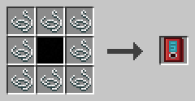

# c0de net Handbook

c0de net adds the libraries c0de_net/http and c0de_net/mail to c0de. With them, programs send HTTP requests to web servers and REST APIs and read the answers, send mail and read mailboxes. This handbook describes the types, the functions, the errors and the settings, with examples.

## Getting started

Programs that use a library include it, like INCLUDE c0de_net/http or INCLUDE c0de_net/mail. Its types and functions start with the library name, like c0de_net/http/HTTP_GET.

Every program, also without the INCLUDE, has the constant `C0DE_NET_VERSION` with the version of c0de net as text, like "0.2.0".

### How requests are sent

The Minecraft server does not send the requests. The game client of the player who runs the process sends them, from that player's computer.

If a player started the process, with a button, a lever or a pressure plate at the trigger block, it is that player. If nobody did, like a timer block or a redstone clock, it is the owner of the trigger block.

That player must be online and have c0de net installed. So a program reaches what that player's computer can reach, including their home network. Other players who press the button send the request from their own computer, never from the owner's.

A request takes time. The CALL line waits until the answer arrives, an error occurs or the timeout has passed. Other processes and the server go on meanwhile.

If the process ends while a request is running, the request is cancelled. After a server restart, a restored process sends its request again. Keep this in mind for requests that change data, like POST and DELETE.

On a single-player world, the server and the client run on the same computer, and requests work the same way.

The functions of c0de_net/mail work the same way: the client of that player connects to the mail server.

### The handbook

This handbook is a red binder in the game, one of the handbooks of c0de (since c0de 0.6.1), with a label in teal.

**Recipe**



Surround an INCLUDE block with eight strings. After all, it's about the World Wide Web.

### Settings

The server has the file `config/c0de_net.properties`. `maxResponseSize` limits the size of an answer in bytes (1 KiB to 16 MiB, default 1 MiB). `maxRequestsPerPlayer` limits how many requests run at the same time on the client of one player (1 to 64, default 8); more requests wait.

For c0de_net/mail, the server has these settings in the same file:

- `enableMail`: false switches the mail library off (default true)
- `maxMailSize`: the bytes of a message SMTP_SEND sends (default 65536)
- `maxRecipients`: the recipients of one message, to, cc and bcc together (default 20)
- `maxMailsPerMinute`: the messages one player may send in a minute (default 10)
- `maxFetchSize`: the bytes one IMAP_FETCH may read (default 1 MiB)
- `maxFetchMessages`: the messages of one IMAP_FETCH or IMAP_SEARCH (default 100)
- `mailTimeout`: the default and the largest timeout of a mail connection in seconds (default 30)
- `allowPort25`: true allows mail connections to port 25 (default false)

Every player has the file `config/c0de_net-client.properties`. With `allowRequests=false`, their client sends no requests, and the requests of their processes raise REQUESTS_DISABLED. With `allowMail=false`, their client sends and reads no mail, and the mail functions of their processes raise MAIL_DISABLED.

Both files are created with the default values. Invalid entries are reported in the log and replaced by the defaults.

## c0de_net/http

The HTTP library has one type for the connection to a server and one function for every HTTP method. All functions return the raw data of the answer, its status and its headers.

### HTTP_CONNECTION

A struct type with the base information of the requests to one server.

Declare it with `VARIABLE api STRUCT c0de_net/http/HTTP_CONNECTION` and set its elements with ASSIGN. Only `server` is needed, all other elements start with defaults that fit most servers.

- `use_ssl` BOOLEAN: true for https, false for http (default false)
- `server` STRING: the server name or IP address, must not be empty
- `port` INTEGER: 1 to 65535, or 0 for 80 or 443 (default 0)
- `base_endpoint` STRING: a path in front of every endpoint, like /api/v2
- `user` STRING: the user name for basic authentication, empty for none
- `password` STRING: the password for basic authentication
- `skip_ssl_validation` BOOLEAN: true to accept any certificate, e.g. a self-signed one (default false)
- `proxy` STRING: an HTTP proxy like http://proxy:3128, empty for none
- `headers` HASH STRING: headers sent with every request, like Content-Type
- `timeout` INTEGER: seconds a request may take, 1 to 300, or 0 for 60 (default 0)

The URL of a request is the protocol, the server, the port, the base endpoint and the endpoint, like `https://api.example.com/v2/users/7`. The endpoint is used as it is, with its query, like `/search?q=stone`. It isn't encoded: a space or another character that a URL can't contain raises INVALID_ARGUMENT, like `/search?city=New York`. Encode such characters yourself, a space as `%20` or, in a query, as `+`. REPLACE of c0de/strings overwrites characters without changing the length of the text, so it can turn every space of `city` into `+`:

```c0de
CALL c0de/strings/INSTR
    PARAMETER text city ;
    PARAMETER search " " ;
    RESULT result gap
WHILE gap ≥ 0 ;
BEGIN
    CALL c0de/strings/REPLACE
        PARAMETER text city ;
        PARAMETER start gap ;
        PARAMETER insert "+" ;
        RESULT result city
    CALL c0de/strings/INSTR
        PARAMETER text city ;
        PARAMETER search " " ;
        RESULT result gap
END WHILE
```

An `Authorization` header in `headers` replaces the basic authentication. The headers Host, Content-Length, Connection, Expect and Upgrade can't be set.

The password is stored in the program like any other value, and everybody who can read the sheet can read it. Pass secrets in as a parameter, from a constant item in the trigger block.

**Example**

```c0de
PROGRAM connect
NOOP
INCLUDE c0de_net/http
NOOP
FUNCTION run
    PARAMETER token STRING
BEGIN
    VARIABLE api STRUCT c0de_net/http/HTTP_CONNECTION
    ASSIGN api.use_ssl TRUE ;
    ASSIGN api.server "api.example.com" ;
    ASSIGN api.base_endpoint "/v2" ;
    ASSIGN api.headers["Authorization"] "Bearer " ⊕ token ;
    ASSIGN api.headers["Content-Type"] "application/json" ;
    ASSIGN api.timeout 10 ;
END FUNCTION
```

### HTTP_GET

Sends a GET request and returns the answer.

GET reads data. Redirects are followed, except from https to http. The results are those of the last answer. A status of 400 or higher raises HTTP_STATUS, and the results are delivered as well.

**Parameters and results**

- `connection` STRUCT c0de_net/http/HTTP_CONNECTION: the server
- `endpoint` STRING: the path behind the base endpoint (optional, default empty)
- result `result` STRING: the raw data of the answer
- result `status` INTEGER: the HTTP status, like 200
- result `headers` HASH STRING: the headers of the answer, with lower-case names

**Example**

```c0de
CALL c0de_net/http/HTTP_GET
    PARAMETER connection api ;
    PARAMETER endpoint "/forecast?city=Berlin" ;
    RESULT result answer
```

### HTTP_HEAD

Sends a HEAD request: like GET, but the answer has no data.

`result` holds the headers of the answer as a JSON object instead, with lower-case names in alphabetical order, like `{"content-length":"12"}`.

**Parameters and results**

- `connection` STRUCT c0de_net/http/HTTP_CONNECTION: the server
- `endpoint` STRING: the path behind the base endpoint (optional, default empty)
- result `result` STRING: the headers as JSON
- result `status` INTEGER: the HTTP status
- result `headers` HASH STRING: the headers of the answer

**Example**

```c0de
CALL c0de_net/http/HTTP_HEAD
    PARAMETER connection api ;
    PARAMETER endpoint "/status" ;
    RESULT status status
```

### HTTP_OPTIONS

Sends an OPTIONS request: asks the server which methods an endpoint supports.

Many servers answer in the header `allow`.

**Parameters and results**

- `connection` STRUCT c0de_net/http/HTTP_CONNECTION: the server
- `endpoint` STRING: the path behind the base endpoint (optional, default empty)
- result `result` STRING: the raw data of the answer
- result `status` INTEGER: the HTTP status
- result `headers` HASH STRING: the headers of the answer

**Example**

```c0de
CALL c0de_net/http/HTTP_OPTIONS
    PARAMETER connection api ;
    PARAMETER endpoint "/lamps" ;
    RESULT headers answerHeaders
```

### HTTP_TRACE

Sends a TRACE request: the server sends the request back as it received it.

Use it to see what a proxy changes. Many servers don't allow TRACE and answer with 405.

**Parameters and results**

- `connection` STRUCT c0de_net/http/HTTP_CONNECTION: the server
- `endpoint` STRING: the path behind the base endpoint (optional, default empty)
- result `result` STRING: the raw data of the answer
- result `status` INTEGER: the HTTP status
- result `headers` HASH STRING: the headers of the answer

**Example**

```c0de
CALL c0de_net/http/HTTP_TRACE
    PARAMETER connection api ;
    RESULT result echo
```

### HTTP_DELETE

Sends a DELETE request: removes something on the server.

Some APIs expect data with it, most don't.

**Parameters and results**

- `connection` STRUCT c0de_net/http/HTTP_CONNECTION: the server
- `endpoint` STRING: the path behind the base endpoint (optional, default empty)
- `data` STRING: the data sent with the request, in UTF-8 (optional, default empty)
- result `result` STRING: the raw data of the answer
- result `status` INTEGER: the HTTP status
- result `headers` HASH STRING: the headers of the answer

**Example**

```c0de
CALL c0de_net/http/HTTP_DELETE
    PARAMETER connection api ;
    PARAMETER endpoint "/timers/3" ;
    RESULT status status
```

### HTTP_PATCH

Sends a PATCH request: changes a part of something on the server.

The data is sent as UTF-8. Set its type in the `Content-Type` header of the connection, like `application/json`.

**Parameters and results**

- `connection` STRUCT c0de_net/http/HTTP_CONNECTION: the server
- `endpoint` STRING: the path behind the base endpoint (optional, default empty)
- `data` STRING: the data sent with the request (optional, default empty)
- result `result` STRING: the raw data of the answer
- result `status` INTEGER: the HTTP status
- result `headers` HASH STRING: the headers of the answer

**Example**

`state` is a BOOLEAN variable with the tag `json: "on"`, so TO_JSON of c0de/strings writes `{"on":false}` (see the example Switching a lamp).

```c0de
CALL c0de/strings/TO_JSON
    PARAMETER value state ;
    RESULT result data
CALL c0de_net/http/HTTP_PATCH
    PARAMETER connection api ;
    PARAMETER endpoint "/lamps/kitchen" ;
    PARAMETER data data ;
    RESULT status status
```

### HTTP_POST

Sends a POST request: sends data to the server, e.g. to create something.

The data is sent as UTF-8. Set its type in the `Content-Type` header of the connection. Make the data with TO_JSON of c0de/strings.

**Parameters and results**

- `connection` STRUCT c0de_net/http/HTTP_CONNECTION: the server
- `endpoint` STRING: the path behind the base endpoint (optional, default empty)
- `data` STRING: the data sent with the request (optional, default empty)
- result `result` STRING: the raw data of the answer
- result `status` INTEGER: the HTTP status
- result `headers` HASH STRING: the headers of the answer

**Example**

```c0de
CALL c0de_net/http/HTTP_POST
    PARAMETER connection api ;
    PARAMETER endpoint "/messages" ;
    PARAMETER data message ;
    RESULT result answer
```

### HTTP_PUT

Sends a PUT request: stores something on the server, replacing what was there.

The data is sent as UTF-8. Set its type in the `Content-Type` header of the connection.

**Parameters and results**

- `connection` STRUCT c0de_net/http/HTTP_CONNECTION: the server
- `endpoint` STRING: the path behind the base endpoint (optional, default empty)
- `data` STRING: the data sent with the request (optional, default empty)
- result `result` STRING: the raw data of the answer
- result `status` INTEGER: the HTTP status
- result `headers` HASH STRING: the headers of the answer

**Example**

```c0de
CALL c0de_net/http/HTTP_PUT
    PARAMETER connection api ;
    PARAMETER endpoint "/lamps/kitchen" ;
    PARAMETER data state ;
    RESULT status status
```

## c0de_net/mail

The mail library sends mail over SMTP and reads and manages mailboxes over IMAP. Mail is plain text, without HTML and attachments.

Every function opens a connection of its own, logs in, does its work and logs out. Nothing stays open between two calls. The functions for messages work in the folder that IMAP_SELECT stored in the IMAP_SERVER variable, so pass that variable to them.

### SMTP_SERVER

A struct type with the connection to a server that sends mail, like the one of your mail provider.

Declare it with `VARIABLE smtp STRUCT c0de_net/mail/SMTP_SERVER` and set its elements with ASSIGN. `server` and `from` are needed, the other elements start with defaults that fit most providers.

- `server` STRING: the server name, like smtp.example.com
- `port` INTEGER: 1 to 65535, or 0 for 465 with `tls` and 587 otherwise (default 0)
- `security` STRING: `starttls` (the default for an empty text), `tls` for a connection that is encrypted from the start, or `none`
- `user` STRING: the user name, empty to send without logging in
- `password` STRING: the password
- `from` STRING: the address of the sender, like `Base computer <steve@example.com>`
- `timeout` INTEGER: seconds a call may take, or 0 for the default of the server (30 seconds, which is also the largest value)
- `skip_ssl_validation` BOOLEAN: true to accept any certificate, e.g. of a server in your home network (default false)

Port 25 is blocked unless the server allows it. Use the submission port of your mail provider, 465 or 587.

The element `password` has the tag `security: "sensitive"`, so the debugging tool shows `***` instead of it. Like for HTTP_CONNECTION, don't write it into the program: pass it in as a parameter, or read it from the vault of c0de.

**Example**

```c0de
PROGRAM postman
NOOP
INCLUDE c0de_net/mail
NOOP
FUNCTION run
    PARAMETER password STRING
BEGIN
    VARIABLE smtp STRUCT c0de_net/mail/SMTP_SERVER
    ASSIGN smtp.server "smtp.example.com" ;
    ASSIGN smtp.user "steve@example.com" ;
    ASSIGN smtp.password password ;
    ASSIGN smtp.from "Base computer <steve@example.com>" ;
END FUNCTION
```

### IMAP_SERVER

A struct type with the connection to a server with mailboxes.

Declare it with `VARIABLE imap STRUCT c0de_net/mail/IMAP_SERVER`. `server` and `user` are needed.

- `server` STRING: the server name, like imap.example.com
- `port` INTEGER: 1 to 65535, or 0 for 993 with `tls` and 143 otherwise (default 0)
- `security` STRING: `tls` (the default for an empty text), `starttls` or `none`
- `user` STRING: the user name
- `password` STRING: the password, sensitive like the one of SMTP_SERVER
- `timeout` INTEGER: as for SMTP_SERVER
- `skip_ssl_validation` BOOLEAN: as for SMTP_SERVER
- `folder` STRING: the selected folder; IMAP_SELECT sets it

**Example**

```c0de
VARIABLE imap STRUCT c0de_net/mail/IMAP_SERVER
ASSIGN imap.server "imap.example.com" ;
ASSIGN imap.user "steve@example.com" ;
ASSIGN imap.password password ;
```

### MAIL

A struct type with a message that IMAP_FETCH read.

- `uid` INTEGER: the number of the message in its folder
- `from` STRING: the sender
- `to` ARRAY STRING: the recipients
- `cc` ARRAY STRING: the recipients of copies
- `subject` STRING: the subject
- `date` TIME: when the message was sent
- `text` STRING: the plain text of the message, empty for a message without one or if IMAP_FETCH didn't read it
- `flags` ARRAY STRING: the flags, like `\Seen`
- `size` INTEGER: the size in bytes

### MAILBOX

A struct type with the status of a folder, from IMAP_STATUS and IMAP_SELECT.

- `name` STRING: the name of the folder
- `messages` INTEGER: the number of messages
- `recent` INTEGER: the number of new messages since the last look
- `unseen` INTEGER: the number of messages without the flag `\Seen`
- `uid_next` INTEGER: the UID the next message will get
- `uid_validity` INTEGER: changes when the UIDs of the folder are given anew

### SMTP_SEND

Sends a plain text message and returns its Message-ID.

All recipients together, to, cc and bcc, may be at most 20, and the message at most 64 KiB. One player may send 10 messages in a minute. The server can change these limits.

**Parameters and results**

- `server` STRUCT c0de_net/mail/SMTP_SERVER: the server
- `to` STRING or ARRAY STRING: the recipients
- `subject` STRING: the subject (optional, default empty)
- `text` STRING: the text (optional, default empty)
- `cc` ARRAY STRING: recipients of copies (optional, default none)
- `bcc` ARRAY STRING: recipients of copies that the others don't see (optional, default none)
- `reply_to` STRING: the address for answers (optional, default empty: the sender)
- result `result` STRING: the Message-ID

**Example**

```c0de
CALL c0de_net/mail/SMTP_SEND
    PARAMETER server smtp ;
    PARAMETER to "alex@example.com" ;
    PARAMETER subject "The farm" ;
    PARAMETER text "The wheat is ready." ;
```

### IMAP_LIST

Returns the names of the folders.

In the pattern, `*` stands for any text and `%` for any text within one level of folders.

**Parameters and results**

- `server` STRUCT c0de_net/mail/IMAP_SERVER: the server
- `pattern` STRING: the folders to list (optional, default `*`: all)
- result `result` ARRAY STRING: the names of the folders

**Example**

```c0de
CALL c0de_net/mail/IMAP_LIST
    PARAMETER server imap ;
    RESULT result folders
```

### IMAP_CREATE

Creates a folder.

A folder that already exists raises MAIL_REJECTED.

**Parameters and results**

- `server` STRUCT c0de_net/mail/IMAP_SERVER: the server
- `folder` STRING: the name of the new folder

**Example**

```c0de
CALL c0de_net/mail/IMAP_CREATE
    PARAMETER server imap ;
    PARAMETER folder "Orders" ;
```

### IMAP_DELETE

Deletes a folder with its messages.

**Parameters and results**

- `server` STRUCT c0de_net/mail/IMAP_SERVER: the server
- `folder` STRING: the name of the folder

**Example**

```c0de
CALL c0de_net/mail/IMAP_DELETE
    PARAMETER server imap ;
    PARAMETER folder "Old orders" ;
```

### IMAP_RENAME

Renames a folder.

**Parameters and results**

- `server` STRUCT c0de_net/mail/IMAP_SERVER: the server
- `folder` STRING: the name of the folder
- `new_name` STRING: its new name

**Example**

```c0de
CALL c0de_net/mail/IMAP_RENAME
    PARAMETER server imap ;
    PARAMETER folder "Orders" ;
    PARAMETER new_name "Old orders" ;
```

### IMAP_STATUS

Returns the status of a folder without selecting it.

**Parameters and results**

- `server` STRUCT c0de_net/mail/IMAP_SERVER: the server
- `folder` STRING: the folder (optional, default empty: the selected folder)
- result `result` STRUCT c0de_net/mail/MAILBOX: its status

**Example**

```c0de
CALL c0de_net/mail/IMAP_STATUS
    PARAMETER server imap ;
    PARAMETER folder "INBOX" ;
    RESULT result box
```

### IMAP_SELECT

Selects a folder: checks that it exists and stores its name in `folder` of the variable.

Pass the variable itself, not a calculation, because the function changes it. The functions for messages, IMAP_SEARCH, IMAP_FETCH, IMAP_STORE, IMAP_MOVE and IMAP_EXPUNGE, work in the selected folder.

**Parameters and results**

- `server` STRUCT c0de_net/mail/IMAP_SERVER: a variable with the server
- `folder` STRING: the folder (optional, default `INBOX`)
- result `result` STRUCT c0de_net/mail/MAILBOX: its status

**Example**

```c0de
CALL c0de_net/mail/IMAP_SELECT
    PARAMETER server imap ;
    PARAMETER folder "INBOX" ;
    RESULT result box
```

### IMAP_SEARCH

Returns the UIDs of the messages of the selected folder that match the criteria, oldest first.

The criteria are words of IMAP, separated by spaces, and all of them must match: `ALL`, `SEEN`, `UNSEEN`, `FLAGGED`, `UNFLAGGED`, `ANSWERED`, `UNANSWERED`, `DELETED`, `UNDELETED`, `DRAFT`, and with a value behind them `FROM`, `TO`, `CC`, `SUBJECT` and `BODY` with a text, `SINCE`, `BEFORE` and `ON` with a date like 1-Nov-2026. A text with spaces is put in double quotes, like `SUBJECT \"wheat order\"` in the text notation. With more matches than the server allows (100), the newest are returned.

**Parameters and results**

- `server` STRUCT c0de_net/mail/IMAP_SERVER: the server with the selected folder
- `criteria` STRING: the criteria (optional, default `ALL`)
- result `result` ARRAY INTEGER: the UIDs

**Example**

```c0de
CALL c0de_net/mail/IMAP_SEARCH
    PARAMETER server imap ;
    PARAMETER criteria "UNSEEN FROM alex" ;
    RESULT result uids
```

### IMAP_FETCH

Reads messages of the selected folder.

A UID that doesn't exist is left out. Reading the text marks a message as seen, like a mail program does; with `text` FALSE, only the other elements are read and the message stays unseen. One call reads at most 100 messages and 1 MiB, or raises RESPONSE_TOO_LARGE.

**Parameters and results**

- `server` STRUCT c0de_net/mail/IMAP_SERVER: the server with the selected folder
- `uids` INTEGER or ARRAY INTEGER: the UIDs of the messages
- `text` BOOLEAN: whether the text is read (optional, default TRUE)
- result `result` ARRAY STRUCT c0de_net/mail/MAIL: the messages

**Example**

```c0de
CALL c0de_net/mail/IMAP_FETCH
    PARAMETER server imap ;
    PARAMETER uids uids ;
    RESULT result letters
```

### IMAP_STORE

Changes the flags of messages of the selected folder.

The flags of IMAP are `\Seen`, `\Answered`, `\Flagged`, `\Deleted` and `\Draft`; other words are keywords, if the server supports them. The mode `add` adds the flags, `remove` removes them and `set` replaces all flags. In the text notation, a backslash is written twice: `"\\Seen"`.

**Parameters and results**

- `server` STRUCT c0de_net/mail/IMAP_SERVER: the server with the selected folder
- `uids` INTEGER or ARRAY INTEGER: the UIDs of the messages
- `flags` STRING or ARRAY STRING: the flags
- `mode` STRING: `add`, `remove` or `set` (optional, default `add`)

**Example**

```c0de
CALL c0de_net/mail/IMAP_STORE
    PARAMETER server imap ;
    PARAMETER uids uids ;
    PARAMETER flags "\\Seen" ;
```

### IMAP_MOVE

Moves messages of the selected folder into another folder.

**Parameters and results**

- `server` STRUCT c0de_net/mail/IMAP_SERVER: the server with the selected folder
- `uids` INTEGER or ARRAY INTEGER: the UIDs of the messages
- `folder` STRING: the folder they move to

**Example**

```c0de
CALL c0de_net/mail/IMAP_MOVE
    PARAMETER server imap ;
    PARAMETER uids uids ;
    PARAMETER folder "Orders" ;
```

### IMAP_EXPUNGE

Removes the messages of the selected folder that have the flag `\Deleted`, and returns how many.

**Parameters and results**

- `server` STRUCT c0de_net/mail/IMAP_SERVER: the server with the selected folder
- result `result` INTEGER: the number of removed messages

**Example**

```c0de
CALL c0de_net/mail/IMAP_EXPUNGE
    PARAMETER server imap ;
    RESULT result removed
```

## Errors

The functions raise these errors. Catch them with a variable of type ERROR on the CALL line, and compare its `code` with the constants of the library, like `c0de_net/http/HTTP_STATUS`. They hold the codes and come with the INCLUDE, like the functions. c0de_net/mail has the constants of the errors it raises, like `c0de_net/mail/REQUEST_FAILED`. INVALID_ARGUMENT and PERMISSION_DENIED are constants of c0de.

### INVALID_ARGUMENT

Code 309: the connection or the endpoint is not valid.

The server is empty, the port is not 0 to 65535, the timeout is not 0 to 300, the proxy is not an http:// URL, or a header can't be sent. The endpoint makes the URL invalid, e.g. with a space (see HTTP_CONNECTION). It is also raised if the request is larger than 1,000,000 bytes.

For c0de_net/mail: a connection without server, an SMTP_SERVER without `from`, an IMAP_SERVER without `user`, an unknown `security`, a timeout above the largest one, an address that isn't valid, unknown criteria of IMAP_SEARCH, an unknown `mode` of IMAP_STORE, or a function for messages without a selected folder.

### PERMISSION_DENIED

Code 311: a mail connection to port 25, which the server doesn't allow.

Port 25 is where mail servers receive mail from each other, and spammers use it too. Send through the submission port of your mail provider, 465 or 587, which needs a user name and password.

### HTTP_STATUS

Code 1000, `c0de_net/http/HTTP_STATUS`: the server answered with a status of 400 or higher.

The message is the status line, like `404 Not Found`. The results `result`, `status` and `headers` are delivered as well, so a program that catches the error can read the answer.

**Example**

```c0de
CALL c0de_net/http/HTTP_GET problem
    PARAMETER connection api ;
    PARAMETER endpoint "/lamps/attic" ;
    RESULT status status
IF problem.code = c0de_net/http/HTTP_STATUS AND status = 404 ;
BEGIN
    CALL PRINT
        PARAMETER value "There is no lamp in the attic" ;
END IF
```

### CLIENT_UNAVAILABLE

Code 1001, `c0de_net/http/CLIENT_UNAVAILABLE`: there is no client to send the request.

The player who runs the process is not online, or their game doesn't have c0de net installed. A process that nobody started and whose trigger block has no owner can't send requests either.

### REQUESTS_DISABLED

Code 1002, `c0de_net/http/REQUESTS_DISABLED`: the client of the player who runs the process doesn't send requests.

That player has set `allowRequests=false` in `config/c0de_net-client.properties`.

### REQUEST_FAILED

Code 1003, `c0de_net/http/REQUEST_FAILED`: the request could not be sent, or there was no answer.

The message names the reason, like an unknown host, a refused connection, a failed SSL handshake or a proxy error. A self-signed certificate needs `skip_ssl_validation`.

### REQUEST_TIMEOUT

Code 1004, `c0de_net/http/REQUEST_TIMEOUT`: there was no complete answer within the timeout of the connection.

The timeout covers the whole request, until the last byte of the answer. Raise `timeout` for slow servers, up to 300 seconds.

### RESPONSE_TOO_LARGE

Code 1005, `c0de_net/http/RESPONSE_TOO_LARGE`: the answer is larger than the server allows.

The limit is `maxResponseSize` in `config/c0de_net.properties`, 1 MiB by default. Ask the API for less data, e.g. one page of a list.

For IMAP_FETCH, the limit is `maxFetchSize`. Read fewer messages at once, or without their text.

### MAIL_DISABLED

Code 1006, `c0de_net/mail/MAIL_DISABLED`: mail is switched off.

The server has set `enableMail=false` in `config/c0de_net.properties`, or the player who runs the process has set `allowMail=false` in `config/c0de_net-client.properties`.

### AUTHENTICATION_FAILED

Code 1007, `c0de_net/mail/AUTHENTICATION_FAILED`: the mail server didn't accept the user name or the password.

Many providers want an app password for programs instead of the password of the account.

### MAIL_REJECTED

Code 1008, `c0de_net/mail/MAIL_REJECTED`: the mail server refused the command.

E.g. a recipient it doesn't accept, a folder that doesn't exist, or a folder to create that exists already. The message is the answer of the server.

### MAIL_LIMIT

Code 1009, `c0de_net/mail/MAIL_LIMIT`: a limit of the server is reached.

More recipients than `maxRecipients`, a larger message than `maxMailSize`, or more messages of one player in a minute than `maxMailsPerMinute`. Wait a minute before sending again.

## Examples

Complete programs that use c0de_net/http and c0de_net/mail. The servers are examples; replace them with the API or mail provider you want to use.

### Weather forecast

Reads a forecast as JSON and prints it.

FROM_JSON of c0de/strings reads the answer into a struct. The elements of the struct must match the keys of the JSON object.

```c0de
PROGRAM weather
NOOP
INCLUDE c0de_net/http
INCLUDE c0de/strings
NOOP
STRUCT forecast
BEGIN
    sky STRING
    temperature FLOAT
END STRUCT
NOOP
FUNCTION show
BEGIN
    VARIABLE api STRUCT c0de_net/http/HTTP_CONNECTION
    VARIABLE answer STRING
    VARIABLE today STRUCT forecast
    ASSIGN api.use_ssl TRUE ;
    ASSIGN api.server "weather.example.com" ;
    CALL c0de_net/http/HTTP_GET
        PARAMETER connection api ;
        PARAMETER endpoint "/today?city=Berlin" ;
        RESULT result answer
    CALL c0de/strings/FROM_JSON
        PARAMETER source answer ;
        PARAMETER destination today ;
    CALL PRINT
        PARAMETER value today.sky ⊕ ", " ⊕ today.temperature ⊕ " °C" ;
END FUNCTION
```

### Switching a lamp

Turns a lamp of a home automation on or off.

Put the trigger block next to a lever and give it a constant item `token` with the token of your home automation. The request is sent from the computer of the player who flips the lever, so only players in your home network can switch it.

```c0de
PROGRAM lamp
NOOP
INCLUDE c0de_net/http
INCLUDE c0de/strings
NOOP
FUNCTION switch
    PARAMETER token STRING
    PARAMETER on BOOLEAN TRUE
    RESULT status INTEGER
BEGIN
    VARIABLE api STRUCT c0de_net/http/HTTP_CONNECTION
    VARIABLE state BOOLEAN TAG(json: "on")
    VARIABLE data STRING
    ASSIGN api.server "192.168.1.20" ;
    ASSIGN api.port 8123 ;
    ASSIGN api.base_endpoint "/api" ;
    ASSIGN api.headers["Authorization"] "Bearer " ⊕ token ;
    ASSIGN api.headers["Content-Type"] "application/json" ;
    ASSIGN state on ;
    CALL c0de/strings/TO_JSON
        PARAMETER value state ;
        RESULT result data
    CALL c0de_net/http/HTTP_PUT
        PARAMETER connection api ;
        PARAMETER endpoint "/lamps/kitchen" ;
        PARAMETER data data ;
        RESULT status status
END FUNCTION
```

### Handling errors

Checks whether a server answers and returns an exit code instead of crashing.

The exit code is 0 if the server answers, 1 if it answers with an error status and 2 if there is no answer. A comparator next to the trigger block reads it.

```c0de
PROGRAM ping
NOOP
INCLUDE c0de_net/http
NOOP
FUNCTION check
    PARAMETER host STRING
BEGIN
    VARIABLE api STRUCT c0de_net/http/HTTP_CONNECTION
    VARIABLE problem ERROR
    ASSIGN api.use_ssl TRUE ;
    ASSIGN api.server host ;
    ASSIGN api.timeout 5 ;
    CALL c0de_net/http/HTTP_HEAD problem
        PARAMETER connection api ;
    IF problem.code = c0de_net/http/HTTP_STATUS ;
    BEGIN
        EXIT 1 ;
    END IF
    IF problem.code ≠ 0 ;
    BEGIN
        EXIT 2 ;
    END IF
    EXIT 0 ;
END FUNCTION
```

### Mail from the farm

Sends a message when the farm is full.

Put the trigger block next to a comparator of the chest of the farm, and give it a constant item `password` with the password of your mail account. The message is sent from the computer of the player who owns the trigger block.

```c0de
PROGRAM farm_mail
NOOP
INCLUDE c0de_net/mail
NOOP
FUNCTION full
    PARAMETER password STRING
BEGIN
    VARIABLE smtp STRUCT c0de_net/mail/SMTP_SERVER
    ASSIGN smtp.server "smtp.example.com" ;
    ASSIGN smtp.user "steve@example.com" ;
    ASSIGN smtp.password password ;
    ASSIGN smtp.from "Farm <steve@example.com>" ;
    CALL c0de_net/mail/SMTP_SEND
        PARAMETER server smtp ;
        PARAMETER to "steve@example.com" ;
        PARAMETER subject "The farm is full" ;
        PARAMETER text "Come and empty the chest." ;
END FUNCTION
```

### Reading orders

Reads the unseen messages with "order" in their subject, prints their subjects and moves them into the folder Orders.

```c0de
PROGRAM orders
NOOP
INCLUDE c0de_net/mail
NOOP
FUNCTION read
    PARAMETER password STRING
    RESULT count INTEGER
BEGIN
    VARIABLE imap STRUCT c0de_net/mail/IMAP_SERVER
    VARIABLE box STRUCT c0de_net/mail/MAILBOX
    VARIABLE uids ARRAY INTEGER
    VARIABLE letters ARRAY STRUCT c0de_net/mail/MAIL
    ASSIGN imap.server "imap.example.com" ;
    ASSIGN imap.user "steve@example.com" ;
    ASSIGN imap.password password ;
    CALL c0de_net/mail/IMAP_SELECT
        PARAMETER server imap ;
        RESULT result box
    CALL c0de_net/mail/IMAP_SEARCH
        PARAMETER server imap ;
        PARAMETER criteria "UNSEEN SUBJECT order" ;
        RESULT result uids
    CALL c0de_net/mail/IMAP_FETCH
        PARAMETER server imap ;
        PARAMETER uids uids ;
        RESULT result letters
    EACH letter letters
    BEGIN
        CALL PRINT
            PARAMETER value letter.from ⊕ ": " ⊕ letter.subject ;
    END EACH
    CALL c0de_net/mail/IMAP_MOVE
        PARAMETER server imap ;
        PARAMETER uids uids ;
        PARAMETER folder "Orders" ;
    CALL LEN
        PARAMETER value uids ;
        RESULT result count
END FUNCTION
```
