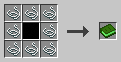

# c0de net Handbook

c0de net adds the library c0de_net/http to c0de. With it, programs send HTTP requests to web servers and REST APIs and read the answers. This handbook describes the connection type, the functions, the errors and the settings, with examples.

## Getting started

Programs that use the library include it with INCLUDE c0de_net/http. Its type and functions start with the library name, like c0de_net/http/HTTP_GET.

### How requests are sent

The Minecraft server does not send the requests. The game client of the player who runs the process sends them, from that player's computer.

If a player started the process, with a button, a lever or a pressure plate at the trigger block, it is that player. If nobody did, like a timer block or a redstone clock, it is the owner of the trigger block.

That player must be online and have c0de net installed. So a program reaches what that player's computer can reach, including their home network. Other players who press the button send the request from their own computer, never from the owner's.

A request takes time. The CALL line waits until the answer arrives, an error occurs or the timeout has passed. Other processes and the server go on meanwhile.

If the process ends while a request is running, the request is cancelled. After a server restart, a restored process sends its request again. Keep this in mind for requests that change data, like POST and DELETE.

On a single-player world, the server and the client run on the same computer, and requests work the same way.

### The handbook

This book is crafted with Patchouli on Minecraft 1.21.1.

**Recipe**



Surround an INCLUDE block with eight strings. After all, it's about the World Wide Web.

### Settings

The server has the file `config/c0de_net.properties`. `maxResponseSize` limits the size of an answer in bytes (1 KiB to 16 MiB, default 1 MiB). `maxRequestsPerPlayer` limits how many requests run at the same time on the client of one player (1 to 64, default 8); more requests wait.

Every player has the file `config/c0de_net-client.properties`. With `allowRequests=false`, their client sends no requests, and the requests of their processes raise REQUESTS_DISABLED.

Both files are created with the default values. Invalid entries are reported in the log and replaced by the defaults.

## c0de_net/http

The HTTP library has one type for the connection to a server and one function for every HTTP method. All functions return the raw data of the answer, its status and its headers.

### HTTP_CONNECTION

A struct type with the base information of the requests to one server.

Declare it with `VARIABLE api STRUCT c0de_net/http/HTTP_CONNECTION` and set its elements with ASSIGN. Only `server` is needed, all other elements start with defaults that fit most servers.

- `use_ssl` BOOLEAN: true for https, false for http (default false)
- `server` STRING: the server name or IP address, must not be empty
- `port` INTEGER: 1 to 65535, or 0 for 80 or 443 (default 0)
- `base_endpoint` STRING: a path in front of every endpoint, like /api/v2
- `user` STRING: the user name for basic authentication, empty for none
- `password` STRING: the password for basic authentication
- `skip_ssl_validation` BOOLEAN: true to accept any certificate, e.g. a self-signed one (default false)
- `proxy` STRING: an HTTP proxy like http://proxy:3128, empty for none
- `headers` HASH STRING: headers sent with every request, like Content-Type
- `timeout` INTEGER: seconds a request may take, 1 to 300, or 0 for 60 (default 0)

The URL of a request is the protocol, the server, the port, the base endpoint and the endpoint, like `https://api.example.com/v2/users/7`. The endpoint is used as it is, with its query, like `/search?q=stone`.

An `Authorization` header in `headers` replaces the basic authentication. The headers Host, Content-Length, Connection, Expect and Upgrade can't be set.

The password is stored in the program like any other value, and everybody who can read the sheet can read it. Pass secrets in as a parameter, from a constant item in the trigger block.

**Example**

```c0de
PROGRAM connect
NOOP
INCLUDE c0de_net/http
NOOP
FUNCTION run
    PARAMETER token STRING
BEGIN
    VARIABLE api STRUCT c0de_net/http/HTTP_CONNECTION
    ASSIGN api.use_ssl TRUE ;
    ASSIGN api.server "api.example.com" ;
    ASSIGN api.base_endpoint "/v2" ;
    ASSIGN api.headers["Authorization"] "Bearer " ⊕ token ;
    ASSIGN api.headers["Content-Type"] "application/json" ;
    ASSIGN api.timeout 10 ;
END FUNCTION
```

### HTTP_GET

Sends a GET request and returns the answer.

GET reads data. Redirects are followed, except from https to http. The results are those of the last answer. A status of 400 or higher raises HTTP_STATUS, and the results are delivered as well.

**Parameters and results**

- `connection` STRUCT c0de_net/http/HTTP_CONNECTION: the server
- `endpoint` STRING: the path behind the base endpoint (optional, default empty)
- result `result` STRING: the raw data of the answer
- result `status` INTEGER: the HTTP status, like 200
- result `headers` HASH STRING: the headers of the answer, with lower-case names

**Example**

```c0de
CALL c0de_net/http/HTTP_GET
    PARAMETER connection api ;
    PARAMETER endpoint "/forecast?city=Berlin" ;
    RESULT result answer
```

### HTTP_HEAD

Sends a HEAD request: like GET, but the answer has no data.

`result` holds the headers of the answer as a JSON object instead, with lower-case names in alphabetical order, like `{"content-length":"12"}`.

**Parameters and results**

- `connection` STRUCT c0de_net/http/HTTP_CONNECTION: the server
- `endpoint` STRING: the path behind the base endpoint (optional, default empty)
- result `result` STRING: the headers as JSON
- result `status` INTEGER: the HTTP status
- result `headers` HASH STRING: the headers of the answer

**Example**

```c0de
CALL c0de_net/http/HTTP_HEAD
    PARAMETER connection api ;
    PARAMETER endpoint "/status" ;
    RESULT status status
```

### HTTP_OPTIONS

Sends an OPTIONS request: asks the server which methods an endpoint supports.

Many servers answer in the header `allow`.

**Parameters and results**

- `connection` STRUCT c0de_net/http/HTTP_CONNECTION: the server
- `endpoint` STRING: the path behind the base endpoint (optional, default empty)
- result `result` STRING: the raw data of the answer
- result `status` INTEGER: the HTTP status
- result `headers` HASH STRING: the headers of the answer

**Example**

```c0de
CALL c0de_net/http/HTTP_OPTIONS
    PARAMETER connection api ;
    PARAMETER endpoint "/lamps" ;
    RESULT headers answerHeaders
```

### HTTP_TRACE

Sends a TRACE request: the server sends the request back as it received it.

Use it to see what a proxy changes. Many servers don't allow TRACE and answer with 405.

**Parameters and results**

- `connection` STRUCT c0de_net/http/HTTP_CONNECTION: the server
- `endpoint` STRING: the path behind the base endpoint (optional, default empty)
- result `result` STRING: the raw data of the answer
- result `status` INTEGER: the HTTP status
- result `headers` HASH STRING: the headers of the answer

**Example**

```c0de
CALL c0de_net/http/HTTP_TRACE
    PARAMETER connection api ;
    RESULT result echo
```

### HTTP_DELETE

Sends a DELETE request: removes something on the server.

Some APIs expect data with it, most don't.

**Parameters and results**

- `connection` STRUCT c0de_net/http/HTTP_CONNECTION: the server
- `endpoint` STRING: the path behind the base endpoint (optional, default empty)
- `data` STRING: the data sent with the request, in UTF-8 (optional, default empty)
- result `result` STRING: the raw data of the answer
- result `status` INTEGER: the HTTP status
- result `headers` HASH STRING: the headers of the answer

**Example**

```c0de
CALL c0de_net/http/HTTP_DELETE
    PARAMETER connection api ;
    PARAMETER endpoint "/timers/3" ;
    RESULT status status
```

### HTTP_PATCH

Sends a PATCH request: changes a part of something on the server.

The data is sent as UTF-8. Set its type in the `Content-Type` header of the connection, like `application/json`.

**Parameters and results**

- `connection` STRUCT c0de_net/http/HTTP_CONNECTION: the server
- `endpoint` STRING: the path behind the base endpoint (optional, default empty)
- `data` STRING: the data sent with the request (optional, default empty)
- result `result` STRING: the raw data of the answer
- result `status` INTEGER: the HTTP status
- result `headers` HASH STRING: the headers of the answer

**Example**

```c0de
CALL c0de_net/http/HTTP_PATCH
    PARAMETER connection api ;
    PARAMETER endpoint "/lamps/kitchen" ;
    PARAMETER data "{\"on\": false}" ;
    RESULT status status
```

### HTTP_POST

Sends a POST request: sends data to the server, e.g. to create something.

The data is sent as UTF-8. Set its type in the `Content-Type` header of the connection. Make the data with TO_JSON of c0de/strings.

**Parameters and results**

- `connection` STRUCT c0de_net/http/HTTP_CONNECTION: the server
- `endpoint` STRING: the path behind the base endpoint (optional, default empty)
- `data` STRING: the data sent with the request (optional, default empty)
- result `result` STRING: the raw data of the answer
- result `status` INTEGER: the HTTP status
- result `headers` HASH STRING: the headers of the answer

**Example**

```c0de
CALL c0de_net/http/HTTP_POST
    PARAMETER connection api ;
    PARAMETER endpoint "/messages" ;
    PARAMETER data message ;
    RESULT result answer
```

### HTTP_PUT

Sends a PUT request: stores something on the server, replacing what was there.

The data is sent as UTF-8. Set its type in the `Content-Type` header of the connection.

**Parameters and results**

- `connection` STRUCT c0de_net/http/HTTP_CONNECTION: the server
- `endpoint` STRING: the path behind the base endpoint (optional, default empty)
- `data` STRING: the data sent with the request (optional, default empty)
- result `result` STRING: the raw data of the answer
- result `status` INTEGER: the HTTP status
- result `headers` HASH STRING: the headers of the answer

**Example**

```c0de
CALL c0de_net/http/HTTP_PUT
    PARAMETER connection api ;
    PARAMETER endpoint "/lamps/kitchen" ;
    PARAMETER data state ;
    RESULT status status
```

## Errors

The functions raise these errors. Catch them with a variable of type ERROR on the CALL line, and check its `code`.

### INVALID_ARGUMENT

Code 309: the connection is not valid.

The server is empty, the port is not 0 to 65535, the timeout is not 0 to 300, the proxy is not an http:// URL, or a header can't be sent. It is also raised if the request is larger than 1,000,000 bytes.

### HTTP_STATUS

Code 1000: the server answered with a status of 400 or higher.

The message is the status line, like `404 Not Found`. The results `result`, `status` and `headers` are delivered as well, so a program that catches the error can read the answer.

**Example**

```c0de
CALL c0de_net/http/HTTP_GET problem
    PARAMETER connection api ;
    PARAMETER endpoint "/lamps/attic" ;
    RESULT status status
IF problem.code = 1000 AND status = 404 ;
BEGIN
    CALL PRINT
        PARAMETER value "There is no lamp in the attic" ;
END IF
```

### CLIENT_UNAVAILABLE

Code 1001: there is no client to send the request.

The player who runs the process is not online, or their game doesn't have c0de net installed. A process that nobody started and whose trigger block has no owner can't send requests either.

### REQUESTS_DISABLED

Code 1002: the client of the player who runs the process doesn't send requests.

That player has set `allowRequests=false` in `config/c0de_net-client.properties`.

### REQUEST_FAILED

Code 1003: the request could not be sent, or there was no answer.

The message names the reason, like an unknown host, a refused connection, a failed SSL handshake or a proxy error. A self-signed certificate needs `skip_ssl_validation`.

### REQUEST_TIMEOUT

Code 1004: there was no complete answer within the timeout of the connection.

The timeout covers the whole request, until the last byte of the answer. Raise `timeout` for slow servers, up to 300 seconds.

### RESPONSE_TOO_LARGE

Code 1005: the answer is larger than the server allows.

The limit is `maxResponseSize` in `config/c0de_net.properties`, 1 MiB by default. Ask the API for less data, e.g. one page of a list.

## Examples

Complete programs that use c0de_net/http. The servers are examples; replace them with the API you want to use.

### Weather forecast

Reads a forecast as JSON and prints it.

FROM_JSON of c0de/strings reads the answer into a struct. The elements of the struct must match the keys of the JSON object.

```c0de
PROGRAM weather
NOOP
INCLUDE c0de_net/http
INCLUDE c0de/strings
NOOP
STRUCT forecast
BEGIN
    sky STRING
    temperature FLOAT
END STRUCT
NOOP
FUNCTION show
BEGIN
    VARIABLE api STRUCT c0de_net/http/HTTP_CONNECTION
    VARIABLE answer STRING
    VARIABLE today STRUCT forecast
    ASSIGN api.use_ssl TRUE ;
    ASSIGN api.server "weather.example.com" ;
    CALL c0de_net/http/HTTP_GET
        PARAMETER connection api ;
        PARAMETER endpoint "/today?city=Berlin" ;
        RESULT result answer
    CALL c0de/strings/FROM_JSON
        PARAMETER source answer ;
        PARAMETER destination today ;
    CALL PRINT
        PARAMETER value today.sky ⊕ ", " ⊕ today.temperature ⊕ " °C" ;
END FUNCTION
```

### Switching a lamp

Turns a lamp of a home automation on or off.

Put the trigger block next to a lever and give it a constant item `token` with the token of your home automation. The request is sent from the computer of the player who flips the lever, so only players in your home network can switch it.

```c0de
PROGRAM lamp
NOOP
INCLUDE c0de_net/http
NOOP
FUNCTION switch
    PARAMETER token STRING
    PARAMETER on BOOLEAN TRUE
    RESULT status INTEGER
BEGIN
    VARIABLE api STRUCT c0de_net/http/HTTP_CONNECTION
    VARIABLE state STRING "{\"on\": false}"
    ASSIGN api.server "192.168.1.20" ;
    ASSIGN api.port 8123 ;
    ASSIGN api.base_endpoint "/api" ;
    ASSIGN api.headers["Authorization"] "Bearer " ⊕ token ;
    ASSIGN api.headers["Content-Type"] "application/json" ;
    IF on ;
    BEGIN
        ASSIGN state "{\"on\": true}" ;
    END IF
    CALL c0de_net/http/HTTP_PUT
        PARAMETER connection api ;
        PARAMETER endpoint "/lamps/kitchen" ;
        PARAMETER data state ;
        RESULT status status
END FUNCTION
```

### Handling errors

Checks whether a server answers and returns an exit code instead of crashing.

The exit code is 0 if the server answers, 1 if it answers with an error status and 2 if there is no answer. A comparator next to the trigger block reads it.

```c0de
PROGRAM ping
NOOP
INCLUDE c0de_net/http
NOOP
FUNCTION check
    PARAMETER host STRING
BEGIN
    VARIABLE api STRUCT c0de_net/http/HTTP_CONNECTION
    VARIABLE problem ERROR
    ASSIGN api.use_ssl TRUE ;
    ASSIGN api.server host ;
    ASSIGN api.timeout 5 ;
    CALL c0de_net/http/HTTP_HEAD problem
        PARAMETER connection api ;
    IF problem.code = 1000 ;
    BEGIN
        EXIT 1 ;
    END IF
    IF problem.code ≠ 0 ;
    BEGIN
        EXIT 2 ;
    END IF
    EXIT 0 ;
END FUNCTION
```
